# Docker

## 0、飞书云笔记

https://b11et3un53m.feishu.cn/wiki/MWQIw4Zvhil0I5ktPHwcoqZdnec


## 1、Docker

### 是什么：

docker是一个运维工具（docker也可以安装在windows系统中，但是一般都是安装在linux系统中的），用于开发、打包和运行应用程序。它将应用程序及其配置和依赖打包成一个整体进行部署安装从而减少了很多部署安装过程中的麻烦。

### 为什么：

#### （1）为什么要使用docker？

传统过程中我们要安装一个软件（比如mysql），这个过程是很复杂的，我们不光需要下载这个软件，下载完成了以后还得去配置它的环境以及对应的依赖然后才能使用，这个过程是很繁琐的。而现在通过docker我们可以实现一次下载将所有它依赖的配置和环境都下载好直接就可以使用，真正实现一键安装。

### 怎么办：

#### （1）如何安装docker？

具体参照这篇文档：https://b11et3un53m.feishu.cn/wiki/Rfocw7ctXij2RBkShcucLZbrn2d

#### （2）如何使用docker完成软件安装与部署?

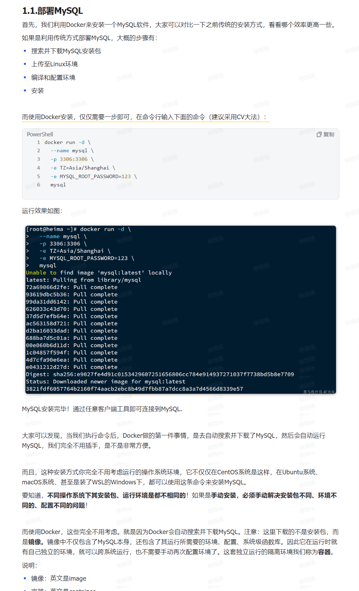

#### （3）镜像：image

可以理解成一个安装包，不过该安装包不仅包含要安装的软件本身（比如mysql），还包含它的正常运行应该具备的所有配置和依赖

#### （4）容器：container

- 通过docker下载了镜像以后，在docker内部部署该镜像的时候会分配出一块独立的环境专门用来放置该镜像
- 不同容器之间彼此隔离互不干扰
- 通过一个镜像可以创建多个容器，不过需要注意不同容器的端口号得设置成不一样的，还有给容器的名字得设置成不一样的（如果创建容器的时候不指定名字的话会随机生成一个容器名））

#### notes：通过docker部署的软件都安装在哪里？

都是安装在docker内部的。

#### notes：为什么通过docker安装部署的软件可以无视运行环境的差异呢？

因为通过docker下载镜像的时候就已经下载了该软件正常运行应该具备的一切依赖和配置了，而且镜像安装在docker的各个容器内部，容器之间互不干扰（否则可能会存在A容器的运行环境影响B容器的运行的情况），所以可以实现一键安装。


#### （5）docker去哪里下载镜像呢？

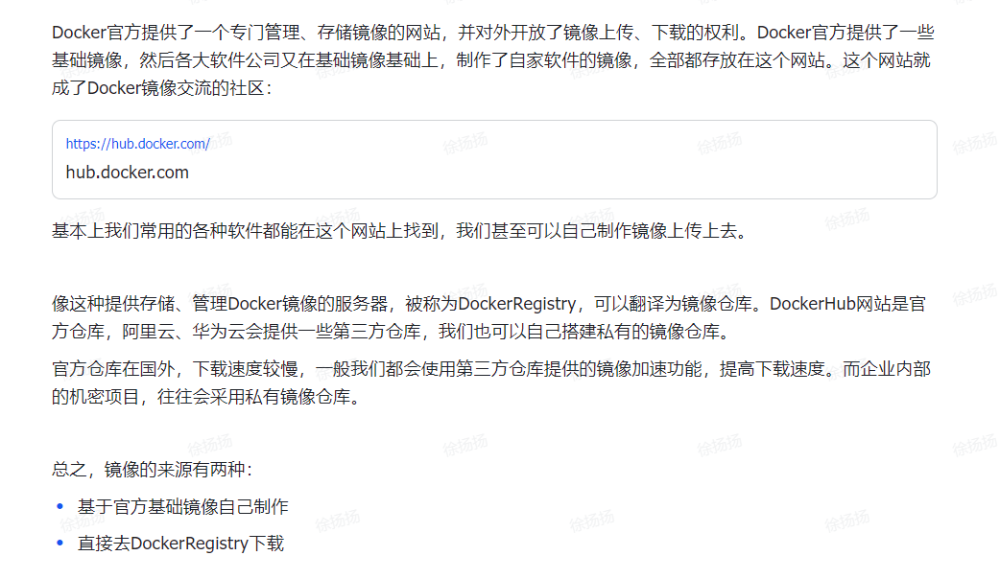

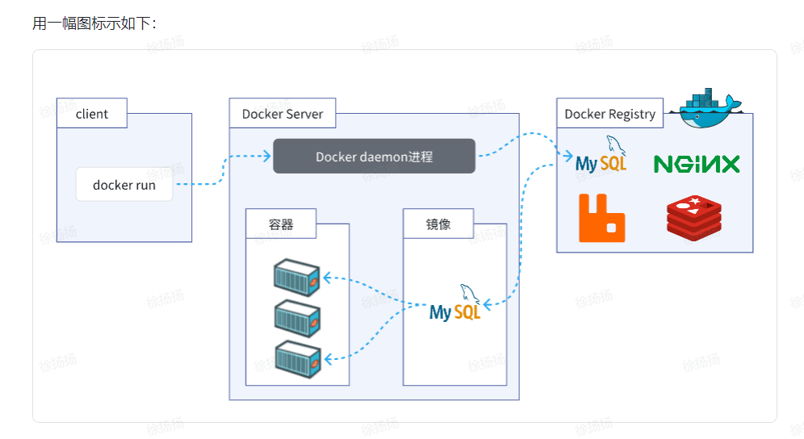

#### （6）docker安装部署命令解读

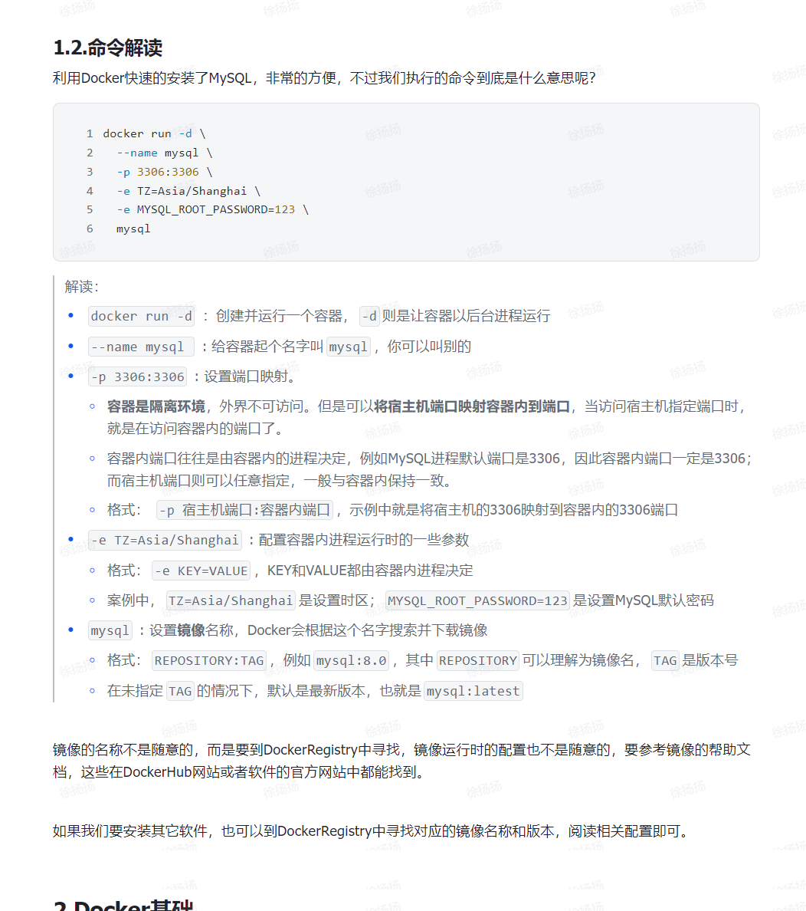


## notes：有关windows主机、linux虚拟机、docker容器三者之间的关系

我现在有一台windows主机，在其上安装了linux虚拟机，在虚拟机中安装了docker，则它们之间有什么样的关系？

### 1. 本地主机 (Local Host)

- **定义**：在你的场景中，本地主机就是这台 **Windows 电脑**，它是你直接操作的物理计算机。
- **作用**：本地主机提供了硬件资源（CPU、内存、磁盘等），这些资源可以被虚拟机使用。

### 2. 虚拟机 (Virtual Machine)

- **定义**：虚拟机是在本地主机上运行的一个**模拟计算环境**。你在 Windows 上安装了一个 **Linux 虚拟机**，这个虚拟机看起来像是一台独立的计算机。
- **作用**：虚拟机从本地主机（Windows）那里“借用”硬件资源，并运行一个完整的操作系统（在你的案例中是 Linux）。你可以在这个虚拟机中像操作一台独立的 Linux 服务器那样工作。
- **宿主与客体关系**：虚拟机安装在本地主机（Windows）上，所以本地主机是虚拟机的**宿主机**

### 3. Docker

- **定义**：Docker 是安装在 **Linux 虚拟机** 上的一个**容器管理平台**。它在 Linux 虚拟机的环境中运行，并用来创建和管理容器。
- **作用**：Docker 在虚拟机中运行，通过虚拟机的 Linux 操作系统来创建容器。容器是一个轻量级的虚拟环境，运行在 Docker 之上，并由 Docker 隔离和管理。
- **宿主与客体关系**：docker安装在linux虚拟机上，所以虚拟机是docker的**宿主机**

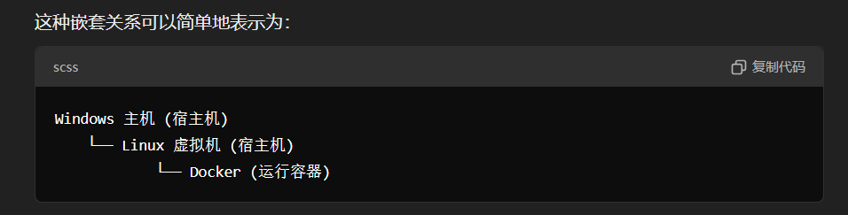


## notes：运行在虚拟机上的 Docker 容器是否能看到 Windows 主机

- **Docker 容器与 Linux 虚拟机的关系**：
  - Docker 容器是在 **Linux 虚拟机**上运行的。容器直接与**虚拟机的网络环境**进行交互，比如容器通过虚拟机的内核和资源来实现网络访问。
  - 从容器的角度来看，**它看到的宿主环境实际上是 Linux 虚拟机**。容器可以访问虚拟机的 IP 地址和虚拟机暴露给它的端口。
- **Docker 容器对 Windows 主机的感知**：
  - Docker 容器和 Windows 主机之间**默认没有直接的网络感知**。容器不直接知道 Windows 主机的 IP 地址，也无法直接访问 Windows 主机上的服务。
  - 如果需要让 Docker 容器与 Windows 主机通信，通常需要**通过虚拟机进行中转**，或者进行一些额外的网络配置（例如在虚拟机和 Docker 网络之间配置桥接）。


## notes：有关windows主机、linux虚拟机、docker容器三者之间ip地址和端口号的关系

### （1）ip地址：

一般情况下，三者的ip地址是互相独立的

###  （2）端口号：

- **独立的端口号范围**：
  - **Windows 主机、Linux 虚拟机、Docker 容器**之间，各自都拥有**完整的 0-65535 的端口号范围**。
  - 它们在各自的网络环境中独立存在，默认情况下，它们的端口号不会互相冲突。
- **端口映射关系**：
  - 为了让不同层级的系统之间能够通信，可以**设置端口映射**，让上层系统通过某个端口访问下层系统的特定服务。
  - 举例：
    - Docker 容器内的服务（例如运行在容器 `8080` 端口的 Web 应用）可以通过 Docker 的端口映射功能，映射到 Linux 虚拟机的某个端口（如 `8081`）。这样，Linux 虚拟机可以通过 `http://<虚拟机IP>:8081` 访问容器内的服务。
    - 类似地，如果 Linux 虚拟机的端口（如 `8081`）需要暴露给 Windows 主机访问，可以在虚拟机软件中设置 NAT 转发或桥接模式下直接访问。


## 2、docker常见命令

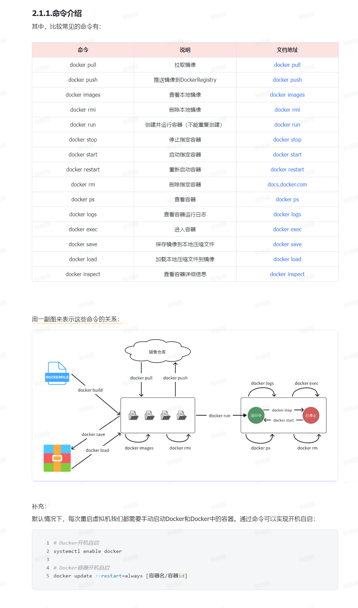

### notes：有关常见命令的一些解释

docker ps：查看运行中的容器

docker ps -a：查看所有容器，包括停止的容器

docker save：将本地镜像保存成压缩文件

docker load：将压缩文件加载成镜像

docker inspect：查看容器或镜像的详细信息（包括创建时间、端口映射等）

docker exec：进入容器内部（容器内部就是一个完整的系统，包括各种运行数据和配置文件等）


### notes：将镜像保存成压缩文件后续该如何使用：`docker load`和`tar -xvf`的区别？

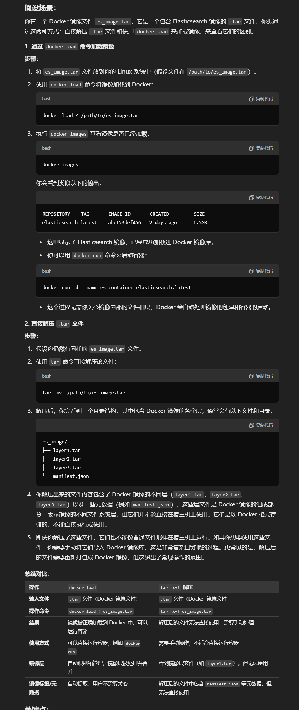


### notes：如何设置docker开启自启以及设置docker内的容器开机自启

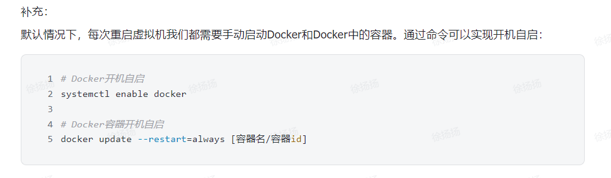

### notes：命令别名

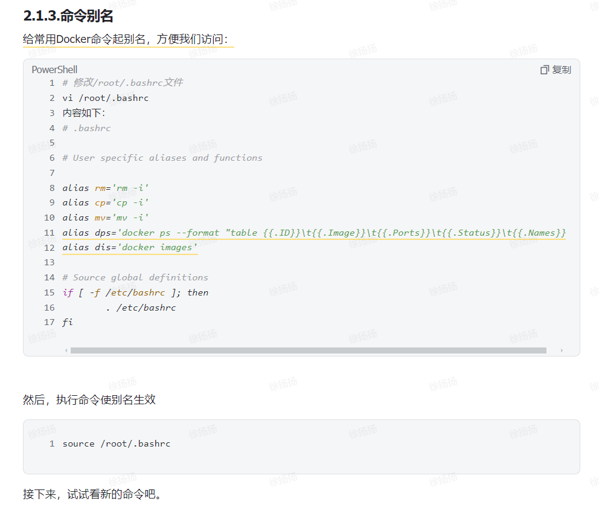


## 3、数据卷

### 是什么：

当在linux系统上创建了docker容器以后则==linux系统会对应一个文件目录，docker容器内部也会对应一个文件目录，这两个目录是相互独立的（你当前在linux系统的话是没法访问docker容器内部目录的，也没法通过cd命令转到docker容器内部目录）==，只有先在linux系统中通过`docker exec`命令进入到docker容器内部才能查看容器内的文件目录，这是非常不方便的。数据卷就是为了解决这个问题诞生的。

**数据卷（volume）**是一个虚拟目录，它的作用是构建**容器内目录**与**宿主机目录**之间的映射关系，其中数据卷对应的宿主机文件有一个默认的位置就是：`/var/lib/docker/volumes`，而数据卷对应的容器内文件的位置就取决于各个容器本身了（需要去`docker hub`官网查看各个容器内文件的位置，就比如说`nginx`容器对应的容器内目录就是：`/user/share/nginx`目录）

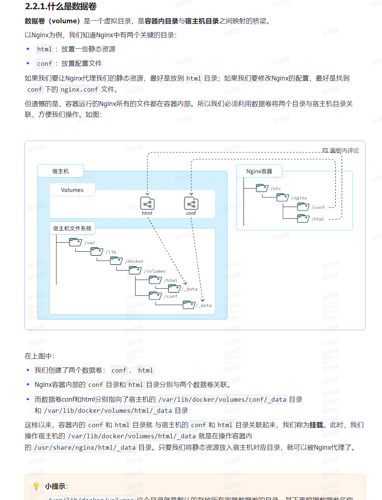

### 为什么：

#### （1）为什么要有数据卷？

容器是隔离环境，容器内程序的文件、配置、运行时产生的数据都在容器内部，我们要读写容器内的文件非常不方便。比如：

- 如果要升级MySQL版本，需要销毁旧容器，那么数据岂不是跟着被销毁了？你说可以找到容器内的mysql数据然后将它复制到容器外部，这样可行但是终归不方便。
- MySQL容器运行后，如果我要修改其中的某些配置该怎么办？你说可以在容器内通过命令修改mysql的配置文件，但是在容器内是不支持vi命令的，因为容器内的环境只是满足正常启动的最小环境并不包含vi这些环境（而且在容器内修改配置需要重新启动容器才能生效）。
- 我想要让Nginx代理我的静态资源怎么办？你说可以将静态资源放到容器内的静态资源目录下，这样可行但是终归不方便（因为此时需要重新构建镜像并启动容器）。

综上所述，通过数据卷加载就显得很有必要。


#### notes：有关linux目录和docker容器目录的理解

我在linux系统上安装了docker，则==linux系统会对应一个目录同时docker容器内部也会对应一个目录，这两个目录和文件系统是彼此独立的（二者都是从根目录 `/` 出发的一系列目录）==，我现在在linux系统的目录上，该如何转到docker容器内部的目录呢？通过cd命令吗？如何判断我当前在哪个目录上呢？

在 Linux 系统上安装了 Docker 后，你的 Linux 系统和 Docker 容器之间是隔离的。容器内部的文件系统和宿主机（Linux 系统）是独立的，因此你无法直接通过 `cd` 命令从宿主机的目录切换到 Docker 容器内部的目录。你需要使用 Docker 提供的命令来进入容器内部。

①如何进入 Docker 容器内部？

如果你想要进入 Docker 容器的文件系统，并查看容器内部的目录结构，使用以下命令：

```bash
docker exec -it <container_name_or_id> bash
```

其中 `<container_name_or_id>` 是容器的名称或 ID。例如，假设容器名为 `es`，命令将是：

```bash
docker exec -it es bash
```

步骤说明：

- `docker exec -it`：此命令用于在运行中的容器中执行命令。

  - `-i`：保持容器的标准输入打开。

  - `-t`：为容器分配一个伪终端，允许你与容器交互。

- `bash`：进入容器后，使用 `bash` shell 交互（前提是容器内部有 `bash`）。

执行该命令后，你将进入容器内部的 bash shell，可以在容器内部像在普通 Linux 系统一样使用 `cd` 命令来导航目录。

②如何判断当前所在的目录？

- 在宿主机上，你可以使用 `pwd` 命令查看当前的目录位置。这个命令会显示你在宿主机的文件系统中的绝对路径。

  ```bash
  pwd
  ```

- 在容器内，执行 `pwd` 命令时，显示的是容器内的路径。例如，你在容器的根目录时执行 `pwd`，它会显示 `/`。

③容器内外的文件系统区别

宿主机和容器内部的文件系统是完全隔离的。因此，容器内的文件路径和宿主机上的文件路径不同。如果你要访问容器内部的目录，需要通过 `docker exec` 进入容器，但是这样特意从linux系统目录跳转到docker容器内目录操作又十分不方便，所以可以通过挂载卷实现在linux目录中访问docker容器内目录的效果。可以让宿主机和容器共享某个特定目录的文件。例如，使用以下命令启动容器时，可以指定将宿主机的目录挂载到容器内的某个路径：

```bash
docker run -v /host/directory:/container/directory <image_name>
```

这样，就能在容器和宿主机之间共享文件。


##### 举例：

好的，以下是一个简单的示例，展示如何通过 Docker 将宿主机的目录挂载到 Docker 容器内部的目录，以及如何访问这些目录。

示例场景：

假设你在宿主机的 `/home/user/data` 目录下有一些文件，并且你希望这些文件能够在 Docker 容器中也能访问到。

- 步骤 1: 创建宿主机目录

​	在宿主机上创建一个目录，并在其中添加一些文件：

```bash
mkdir -p /home/user/data
echo "This is a test file" > /home/user/data/test.txt
```

​	这样，宿主机的 `/home/user/data` 目录下就有了一个 `test.txt` 文件。

- 步骤 2: 启动 Docker 容器并挂载宿主机目录

​	假设你要启动一个 Ubuntu 容器，并将宿主机的 `/home/user/data` 目录挂载到容器内的 `/mnt/data` 目录。可以使用如下命令：

```bash
docker run -it -v /home/user/data:/mnt/data ubuntu bash
```

​	这条命令做了以下几件事：

​	`docker run -it`：启动一个交互式容器。

​	`-v /home/user/data:/mnt/data`：将宿主机的 `/home/user/data` 目录挂载到容器内的 `/mnt/data` 目录。

​	`ubuntu bash`：启动一个 Ubuntu 容器，并进入 `bash` shell。

- 步骤 3: 在容器内访问宿主机目录

​	通过`docker exec`命令进入容器后，你可以看到容器内 `/mnt/data` 目录已经包含了宿主机 `/home/user/data` 目录中的内容：

```bash
root@container_id:/# ls /mnt/data
test.txt
```

​	你可以直接在容器内操作这个文件，就像它是在容器内部一样。例如，你可以使用 `cat` 命令查看 `test.txt` 的内容：

```bash
root@container_id:/# cat /mnt/data/test.txt
This is a test file
```

- 步骤 4: 在宿主机上修改文件

​	如果你退出容器并返回宿主机，你会发现 `/home/user/data/test.txt` 文件的内容依然可以访问和修改：

```bash
cat /home/user/data/test.txt
This is a test file
```


#### （2）为什么通过数据卷挂载而不是直接构建容器内目录和宿主机目录之间的映射关系？

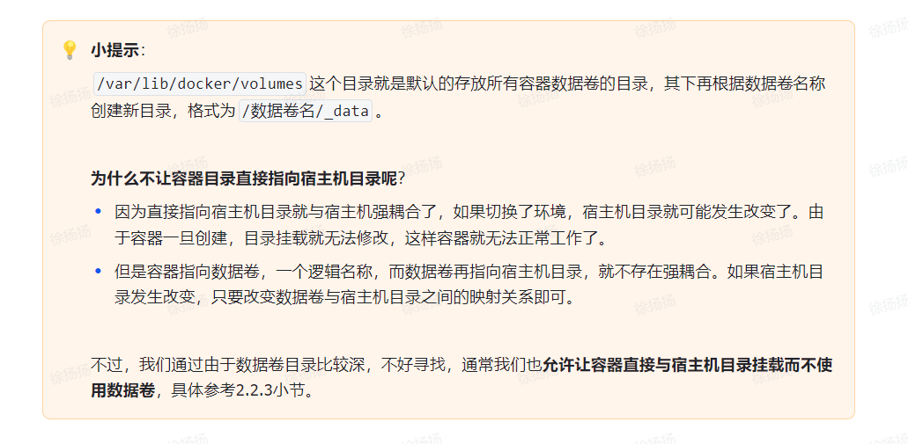

### 怎么办：

#### （1）常用数据卷命令

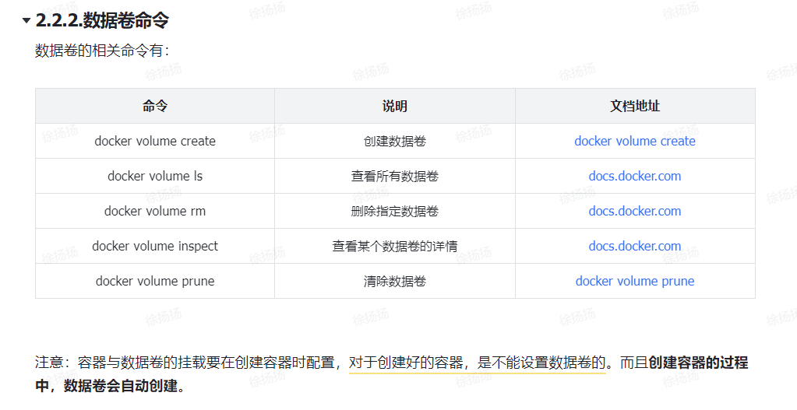

#### （2）如何挂载数据卷？（就是将数据卷分别与宿主机目录和容器内目录构建映射）

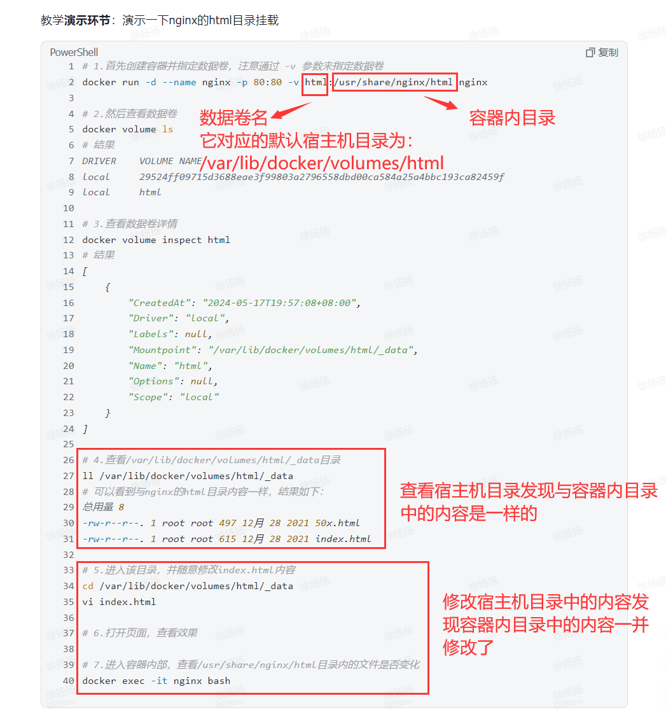

#### （3）匿名数据卷

##### 是什么：

如果在创建容器的时候没有指明数据卷的话则docker会创建一个默认的数据卷，该数据卷对应的宿主机目录就在默认位置处，该数据卷对应的容器内目录取决于各个容器本身，该数据卷的名字是一个随机名称

##### 怎么办：

###### ①匿名数据卷示例

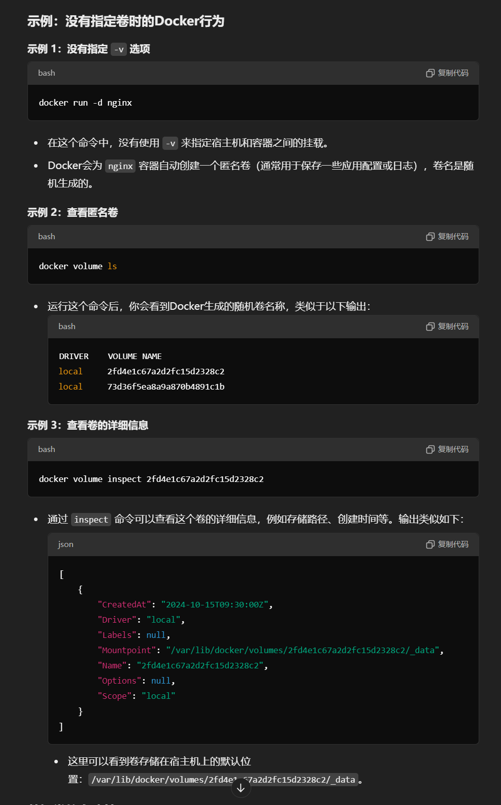


### notes：挂载本地目录或文件

#### 是什么：

直接将宿主机的本地目录或文件与容器内的目录或文件之间构建映射，越过了中间的数据卷的过程

#### 为什么：

##### （1）为什么要直接将宿主机目录与容器内目录之间进行挂载？

因为当采用数据卷挂载的时候，有时候数据卷对应的宿主机目录位置太深了不方便查看

#### 怎么办：

##### （1）如何挂载本地目录到容器内目录呢？

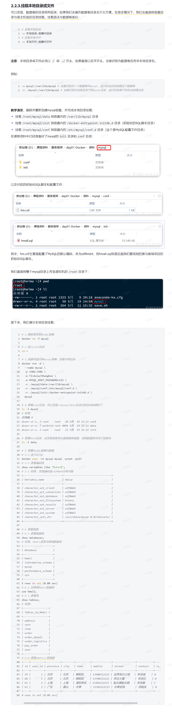


## 4、镜像

### 是什么：

镜像就像一个安装包，不过它不仅仅包含要安装的软件本身还包含它正常运行所需要的一切环境和依赖，通过将软件、环境、依赖等打包到一起，真正实现了软件的一键安装

### 为什么：

#### （1）为什么要使用镜像？

- 有了镜像以后就可以无视操作系统的差异，真正实现一键安装，否则还要费心费力的去配置环境下载依赖等
- 镜像在docker中安装时会创建出一个独立的空间：容器。各个容器之间是互不干扰的，因此也不会出现a容器的运行环境影响b容器运行这样的情况。

### 怎么办：

#### （1）镜像的结构

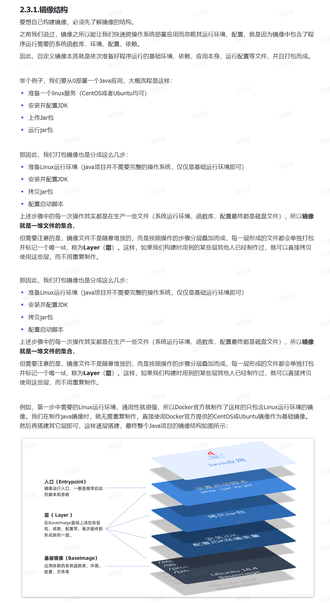


##### notes：一个Java项目对应的jar包与对应的镜像的区别

主要在于下面这幅图，镜像不仅包含jar包还包含运行环境、依赖等

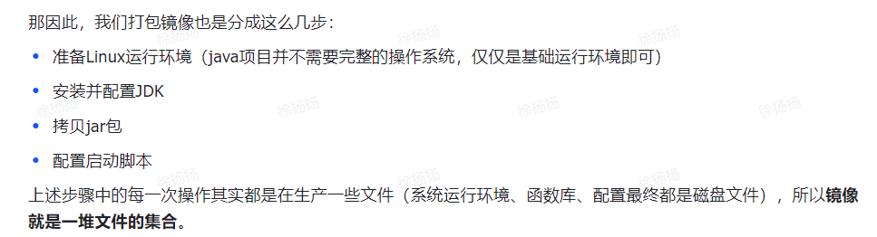


#### （2）dockerfile

##### 是什么：

`dockerfile`是一个文件，用特定的语法来说明`docker`镜像是如何构建起来，`docker`镜像的构建过程中每一层需要做哪些事情包括基础镜像、环境的配置、本地`jar`包拷贝到镜像中的过程、启动脚本的设置等，后续通过命令经由`dockerfile`文件来创建镜像（其中基础镜像的下载还是去镜像仓库中下载的）

##### 怎么办：

###### ①如何编写dockerfile文件？

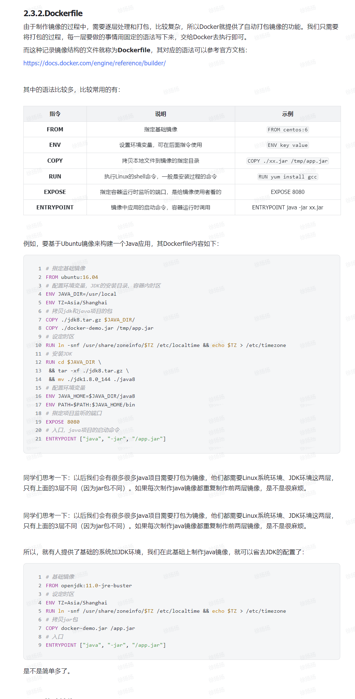


###### ②有了dockerfile文件以后如何构建镜像？

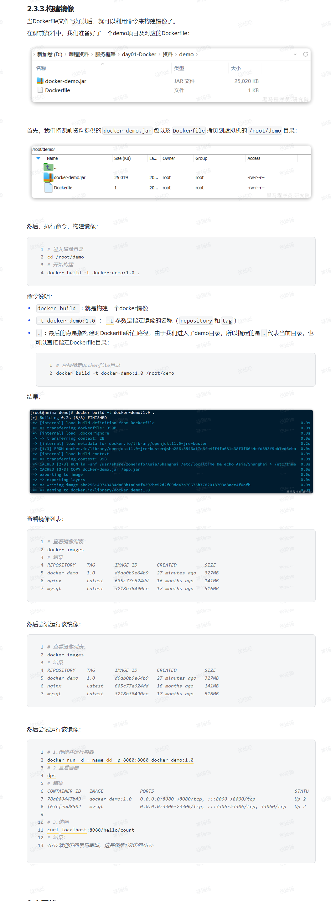


## 5、docker网络

### 是什么：

在docker内部可以自己创建网络，不同的容器通过连接到同一个网络可以实现互相通信（直接通过容器名进行通信，不用通过容器的ip地址）

### 为什么：

#### （1）为什么要创建docker网络？

既然docker内的容器相互之间可以通过ip地址进行访问为什么又要创建docker网络呢？

因为虽然docker容器之间可以通过ip地址互相访问，但是这个ip地址不是固定的，可能下一次启动容器这个ip地址就变化了，因此不好掌控，通过创建docker网络可以实现容器之间相互通过容器名进行访问这样就不用知道彼此的ip地址了

### 怎么办：

#### （1）如何通过docker网络实现容器之间的互相通信？

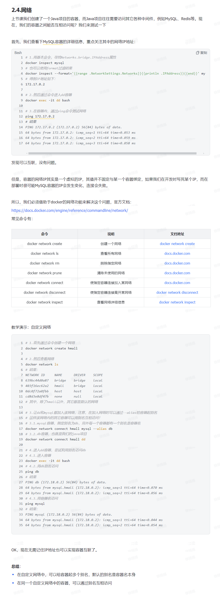


## 6、在docker中进行项目部署

### 是什么：

在docker中通过镜像构建容器从而部署项目

### 怎么办：

#### （1）在docker中如何部署后端工程？

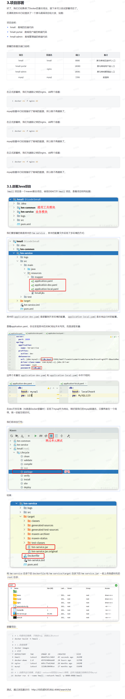

==上述过程中的dockerfile文件是提前编写好的，不是idea打包过程中自动生成的==


#### （2）在docker中如何部署前端工程？

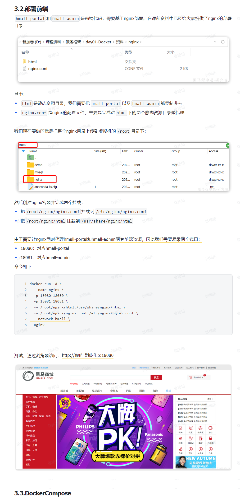


## 7、dockercompose

### 是什么：

dockercompose是一个yaml格式的文件，在其中说明了一个完整的项目所依赖的各个容器的构建过程，通过该文件可以实现一次性创建多个容器

### 为什么：

#### （1）为什么要使用dockercompose?

一个完整的项目它的运行需要依赖于多个组件，如果在docker中部署该项目的话则需要构建多个容器，如果每次都部署一个容器的话则太麻烦了，所以使用dockercompose一次性部署多个容器

### 怎么办：

#### （1）如何编写dockercompose文件实现一次性创建多个容器的逻辑？

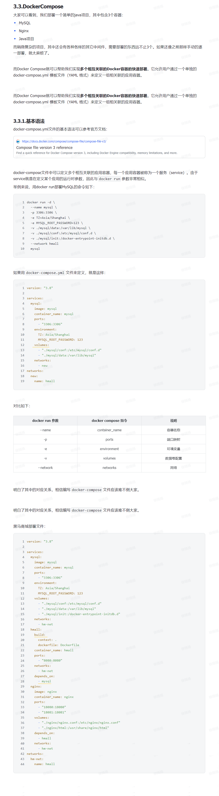

#### （2）有了dockercompose文件之后如何一次性创建多个容器？

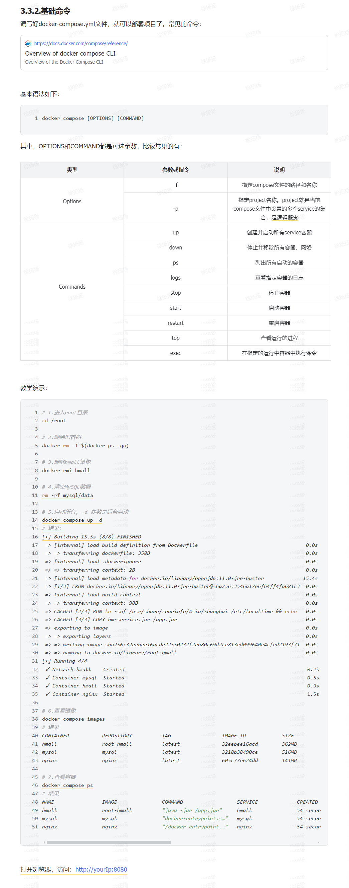