# MyBatis

## 是什么：

`MyBatis` 是一个 `Java` 的持久层框架，它简化了与数据库的交互。它允许开发者通过 `config.xml`或`application.yaml`文件来管理数据库的连接、通过`mapper.xml`文件 或注解来配置 SQL 语句，提供了灵活性与可控性。传统方法中通过`jdbc`配置数据库和编写`sql`语句是很麻烦的而且代码是在业务代码中写死的，而现在通过`mybatis`框架封装了`jdbc`因此可以很容易的进行数据库的交互而且有关数据库的配置项都是写在`config.xml`或`application.yaml`文件中的（非业务代码中），因此可以很容易的进行修改。

## 为什么：

### （1）为什么要学习`MyBatis`？

- **简化数据访问**：它封装了 JDBC 的复杂性，简化了数据库的操作，让开发者能够更专注于业务逻辑。

- **易于维护**：将 SQL 语句与 Java 代码分开，可以更容易地管理和维护 SQL 语句，尤其在项目规模较大时。

- **支持复杂查询**：MyBatis 支持动态 SQL，可以根据不同条件生成 SQL，从而支持复杂的查询逻辑。

- **与多种数据库兼容**：MyBatis 可以与多种类型的数据库一起使用，只需更改配置文件即可适配不同的数据库。

## 怎么办：

### （1）在`springboot`中如何使用`mybatis`?

1. ==引入依赖==

在项目的 `pom.xml` 文件中引入 `MyBatis` 及数据库驱动的依赖。如果是使用 `Spring Boot`，还需要引入 `MyBatis-Spring-Boot-Starter` 依赖。

```xml
<!-- MyBatis 和数据库驱动依赖 -->
<dependency>
    <groupId>org.mybatis.spring.boot</groupId>
    <artifactId>mybatis-spring-boot-starter</artifactId>
    <version>2.x.x</version>
</dependency>
<dependency>
    <groupId>mysql</groupId>
    <artifactId>mysql-connector-java</artifactId>
    <version>8.x.x</version>
</dependency>
```

2. ==编写`mybatis-config.xml`或`application.yaml`文件，配置数据库连接信息==

**配置数据库连接信息**：

- **传统方式**：编写 `mybatis-config.xml` 文件来配置数据库连接。
- **Spring Boot 方式**：使用 `application.yml` 或 `application.properties` 来配置数据库连接。

示例（`application.yml`）：

```yml
spring:
  datasource:
    url: jdbc:mysql://localhost:3306/mydb
    username: root
    password: abc123
mybatis:
  mapper-locations: classpath:mapper/*.xml  # 定义了mapper.xml所在的路径。
  type-aliases-package: com.example.pojo    # 定义了实体类所在的包路径。
```

3. ==创建`mapper`接口，在其中编写数据库增删改查方法（不用写方法体）==

在 `mapper` 接口中定义增删改查方法（不用写方法体）

```java
@Mapper
public interface UserMapper {
    User selectUserById(int id);
}
```

4. ==编写`mapper`接口对应的`mapper.xml`文件，里面编写数据库增删改查对应的`sql`语句==

在 `mapper.xml` 文件定义`sql`语句：`mapper`接口中的方法与对应的`xml`文件配合使用。

```xml
<mapper namespace="com.example.mapper.UserMapper">
    <select id="selectUserById" resultType="com.example.pojo.User">
        SELECT * FROM tb_user WHERE id = #{id}
    </select>
</mapper>
```

5. ==创建Service层，调用mapper接口中的方法实现数据库的增删改查==

**Service 层使用 Mapper**：在 Service 层中通过注入 `Mapper` 接口，直接调用增删改查方法。

```java
@Service
public class UserService {
    @Autowired
    private UserMapper userMapper;

    public User getUserById(int id) {
        return userMapper.selectUserById(id);
    }
}
```

#### notes：上述步骤④中除了通过`mapper.xml`文件的方式外，还可以通过注解实现简单的增删改查（对于复杂的增删改查逻辑依然需要通过`mapper.xml`文件）

不想使用 `mapper.xml` 文件，而是希望直接在 `Mapper` 接口中定义 SQL 语句，那么你需要使用注解，比如 `@Select`、`@Insert`、`@Update`、`@Delete` 等。

**Mapper 接口（使用注解）**：

```java
@Mapper
public interface UserMapper {
    @Select("SELECT * FROM tb_user WHERE id = #{id}")
    User selectUserById(int id);  // 这里使用 @Select 注解
}
```

此时就不需要再写`mapper.xml`文件了


#### notes：单纯的使用`mybatis`和通过`springboot`管理`mybatis`有什么区别？

- 单纯使用`mybatis`：
  - 需要手动加载`mybatis`的核心配置文件（配置数据库连接以及标注mapper.xml文件所在位置的）
  - 需要手动创建`sqlsession`对象

- `springboot`集成`mybatis`：
  - `springboot`自动通过配置文件（如 `application.yml`）读取数据库连接信息和`mapper.xml`文件所在的位置
  - `springboot`自动创建`sqlsession`对象

如果使用 **Spring Boot**，MyBatis 的很多配置会自动管理，你不需要显式编写 `mybatis-config.xml`，只需要在 `application.yml` 中配置好数据源即可。综上，现在一般都是用springboot集成mybatis进行操作的。


## notes：下面的步骤都是单纯使用`mybatis`的过程，太复杂了，现在都是`springboot`集成`mybatis`进行操作的，所以下面简单过一遍就行，可以看看其中增删改查的用法）


## 1、mybatis官网

https://mybatis.org/mybatis-3/zh_CN/getting-started.html

里面有很多关于mybatis用法的介绍


## 2、mybatis快速入门

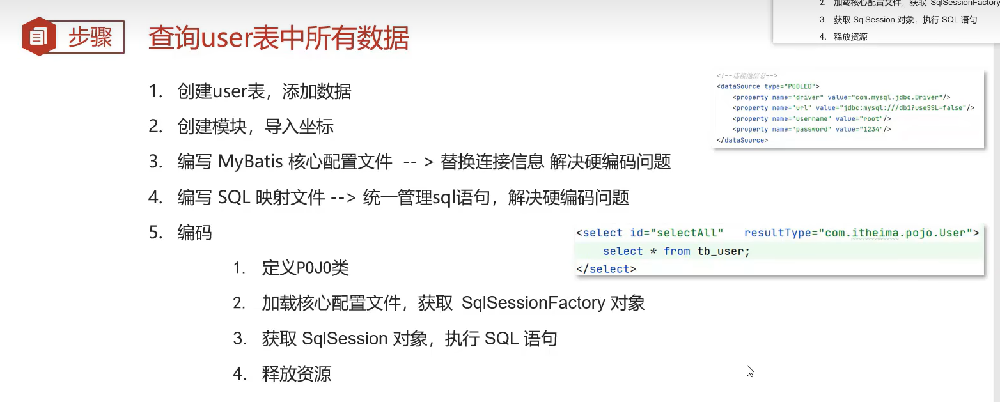

### （1）创建数据表，添加数据

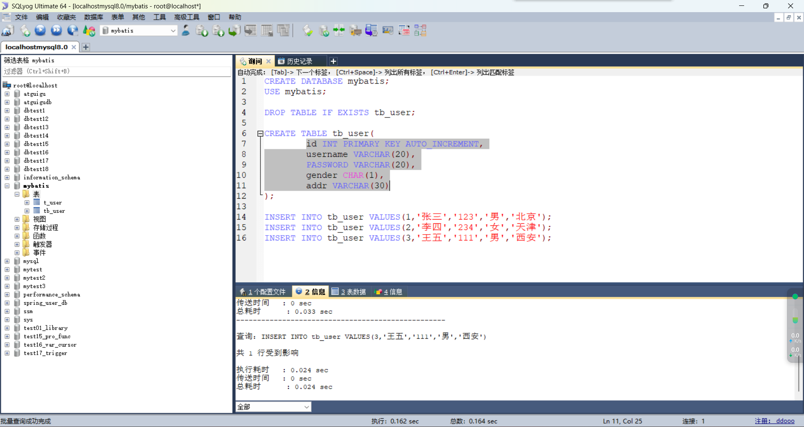

### （2）创建模块，添加依赖

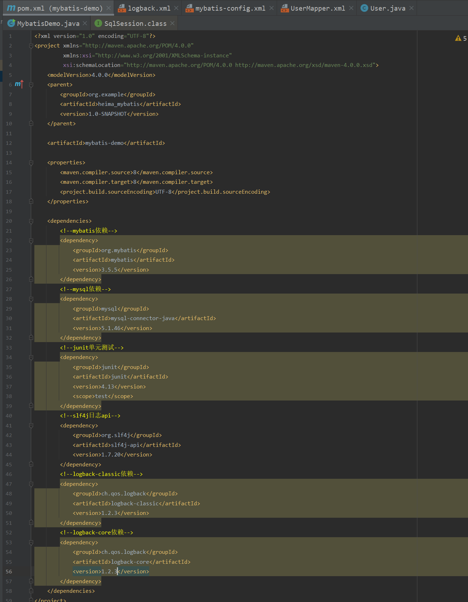

### （3）编写核心配置文件

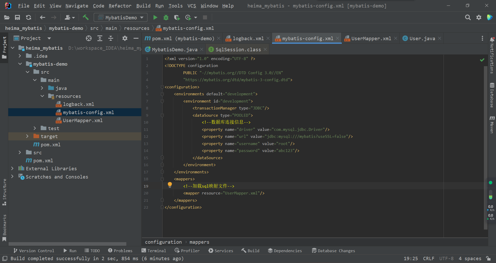

### （4）编写sql映射文件

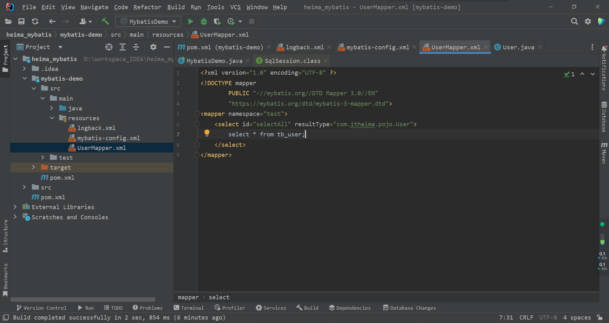

### （5）编码

#### ①定义pojo类

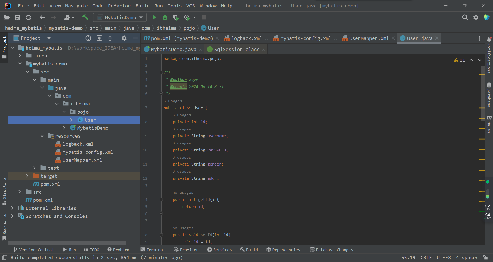

#### ②加载核心配置文件

#### ③获取sqlsession对象

#### ④执行sql语句

#### ⑤释放资源

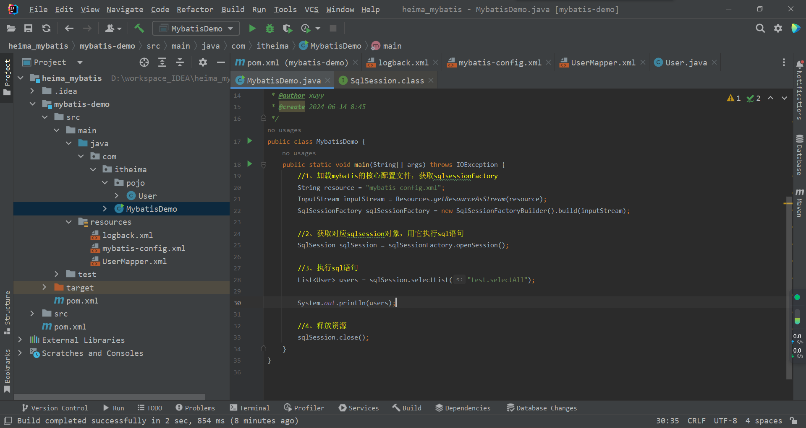


### notes：多行一起编辑的快捷键

`Alt`+`鼠标左键`（其中鼠标左键不要松开一直往下移），由此就能一次性编辑多行了

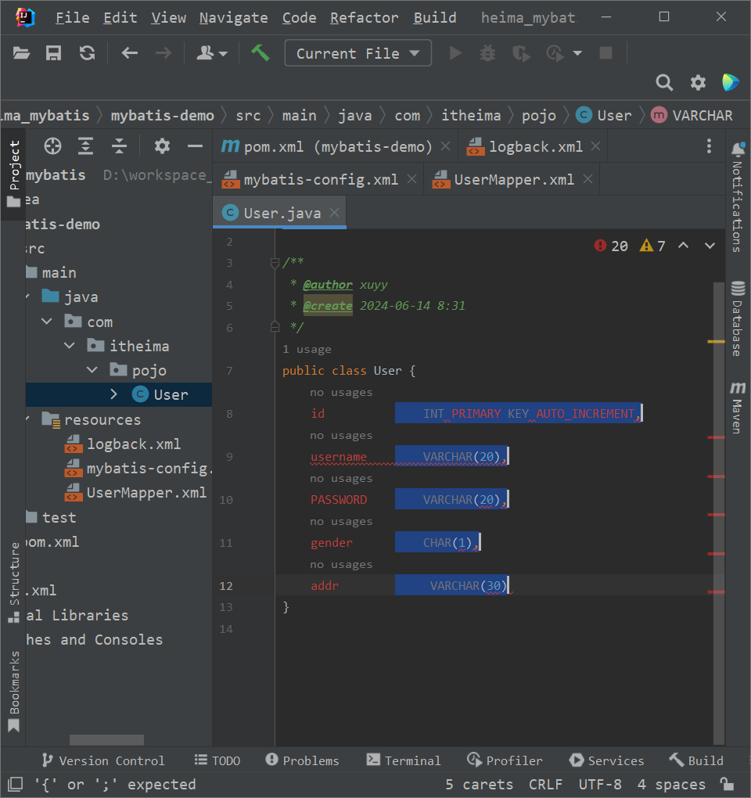


## 3、Mapper代理开发

## notes：Mapper

### 是什么：

在mybatis中mapper是一个Java接口，其中定义了对于数据库的增删改查操作（==不用具体实现==），我们为这个接口创建xml映射文件（==在其中定义和增删改查操作对应的sql语句，同时在映射文件的`namespace`属性中标注Mapper接口的全类名由此就将mapper接口和对应的映射文件之间建立起了一一对应的关系==），然后在mybatis的配置文件中注册接口或xml映射文件最后就可以使用MyBatis的`SqlSession`对象来获取这个Mapper接口的实例并调用其方法进行数据库操作。

#### notes：如何在核心配置文件`mybatis-config.xml`中注册`mapper`接口或映射文件（就是告诉项目`mapper`接口或对应的`mapper.xml`文件在哪里，在`springboot`集成`mybatis`中可以直接在`application.yaml`文件中标注`mapper`接口和对应的`mapper.xml`文件的位置）

#### 方式一：在核心配置文件中直接注册映射文件

在`mybatis`的核心配置文件`mybatis-config.xml`中添加`mapper`元素指向你的映射文件。这种方式直接关联映射文件而不是接口，MyBatis将自动为接口生成代理实现。这通常是最直接的方式。

```xml
<configuration>
    <mappers>
        <mapper resource="path/to/mapper/UserMapper.xml"/>
    </mappers>
</configuration>
```

#### 方式二：在核心配置文件中注册接口

如果你使用了基于注解的SQL而不是XML文件，或者你希望通过接口直接注册（MyBatis可以自动查找与接口同名的XML文件），你可以使用`package`或者`class`方式来注册。

- **通过类名注册**：

```xml
<configuration>
    <mappers>
        <mapper class="com.example.mapper.UserMapper"/>
    </mappers>
</configuration>
```

这里的`class`属性是接口的全类名。

- 通过扫描包注册

```xml
<configuration>
    <mappers>
        <package name="com.example.mapper"/>
    </mappers>
</configuration>
```

这种方式可以自动注册指定包下的所有Mapper接口。MyBatis将尝试为每个接口寻找同名的XML文件。


### 为什么：

#### （1）为什么要使用Mapper代理开发？

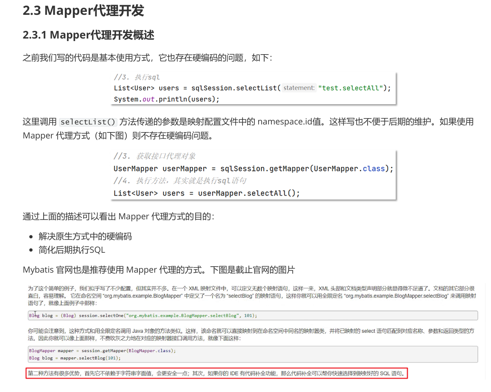

### 怎么办：

#### （1）如何使用Mapper代理开发

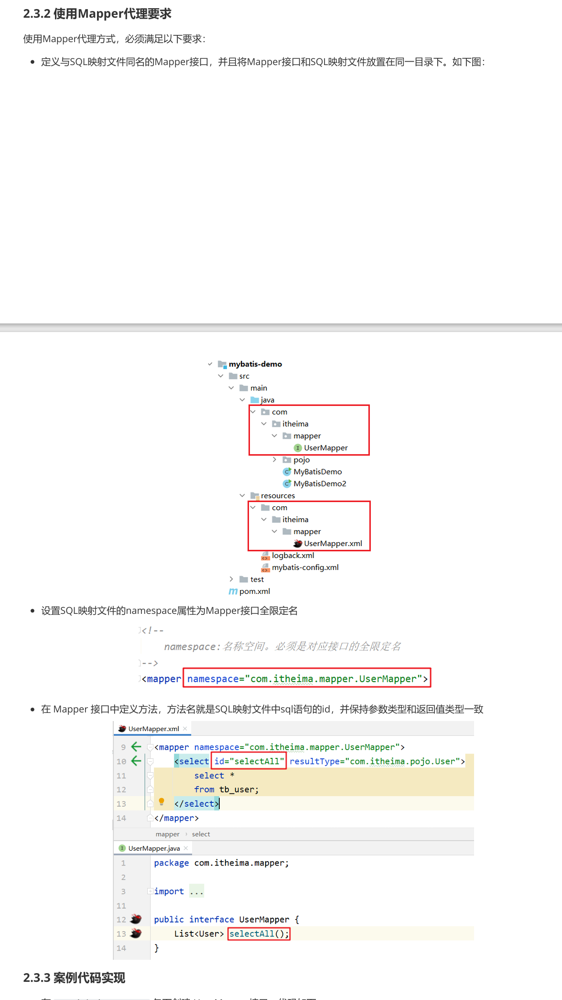

#### notes：`Mapper`接口和对应的`xml`映射文件必须放在同一个目录下，这该咋办？

由于`xml`映射文件都是放在`resources`目录下的，而`mapper`接口都是放在`java.com.itheima.mapper`目录下，这根本不在同一个目录下啊，而且还不能将`xml`映射文件直接移动到`mapper`接口所在的目录，因为这样不方便管理映射文件；我们知道`java`目录和`resources`目录都是类路径，在编译的时候它们也是同级的，所以我们直接在`resources`目录下创建`com.itheima.mapper`目录然后将`xml`映射文件放在这个目录里面由此`mapper`接口就和对应的`xml`映射文件在同一个目录下了，但是这里还有一点需要注意那就是在`resources`目录下是没法创建`package`的只能创建`directory`，而且创建分层`directory`的话是不能使用`.`作为分隔符的而要使用`/`作为分隔符，所以最终我们是在`resources`目录下创建`com/itheima/mapper`的directory，然后将xml映射文件放在其中


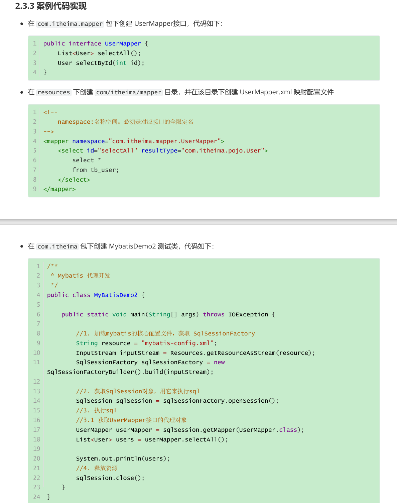


## 4、MyBatis核心配置文件

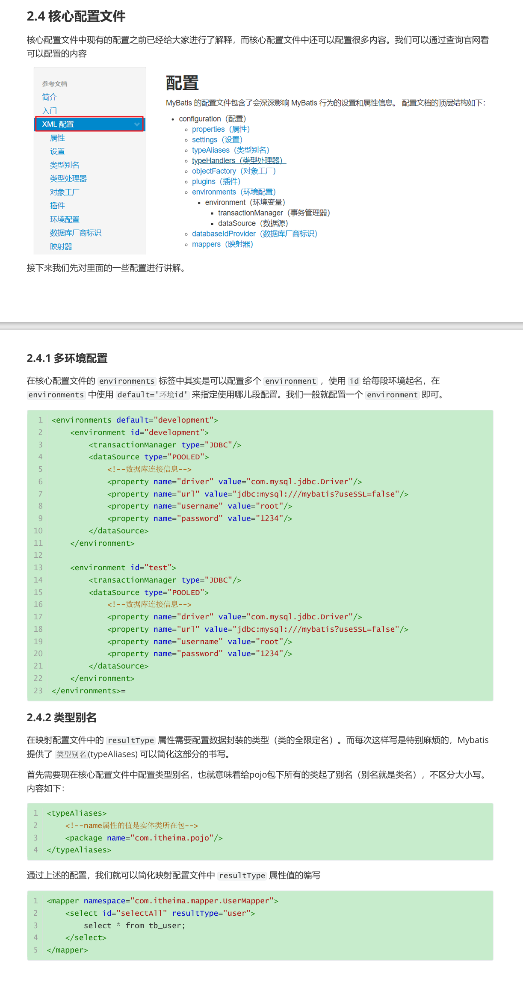


## 5、`mapper.xml`文件实现CRUD

### （1）前期准备

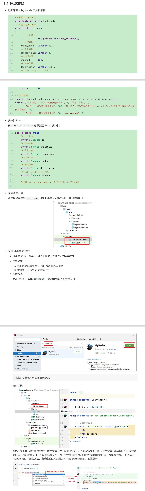


### （2）增加

#### ①增加数据不返回结果

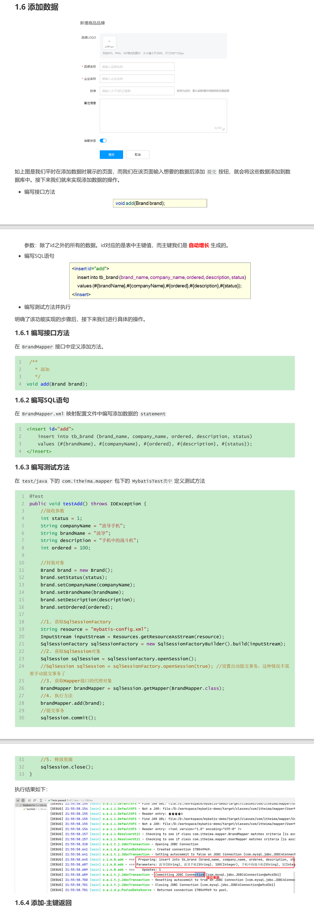


#### ②增加数据返回主键值

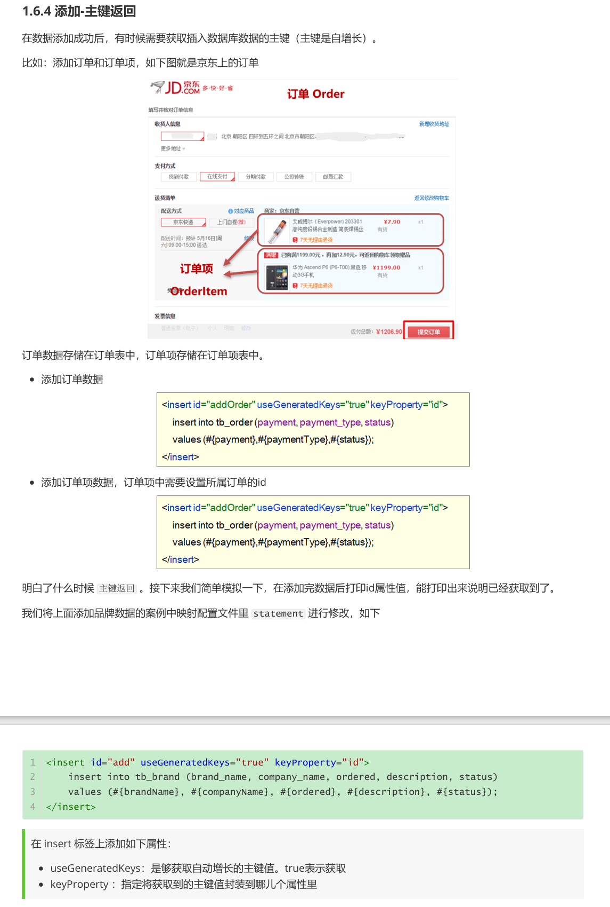


### （3）删除

#### ①删除一行数据

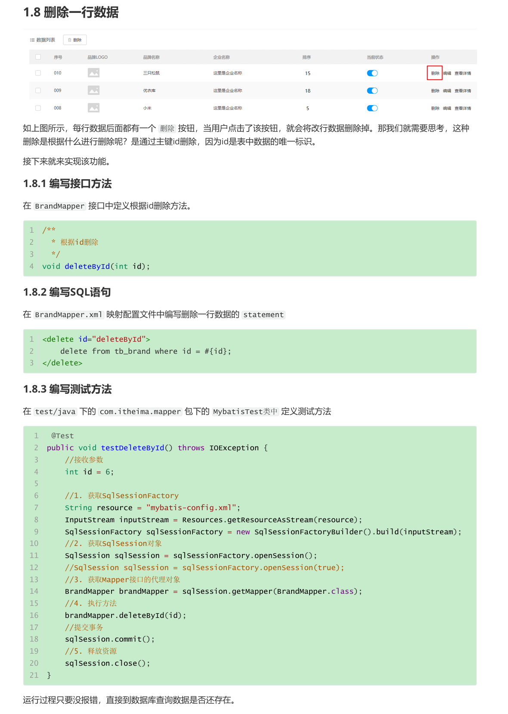


#### ②删除多行数据

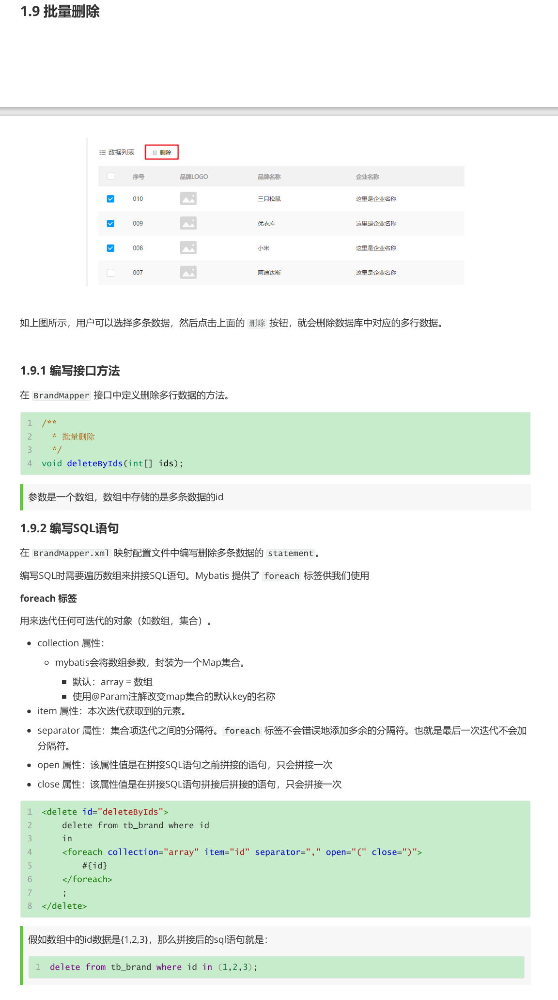


##### notes：当接口方法中传入一个数组对象的时候在sql映射文件中该如何找到这个数组对象

###### 方式1：在mybatis中默认是用`array`来代表这个数组，在映射文件中使用的时候直接调用`array`

- 在接口中定义方法，方法参数是数组对象

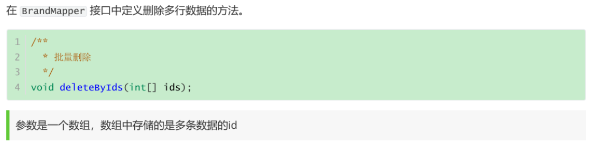

- 在sql映射文件中使用`array`指向这个数组

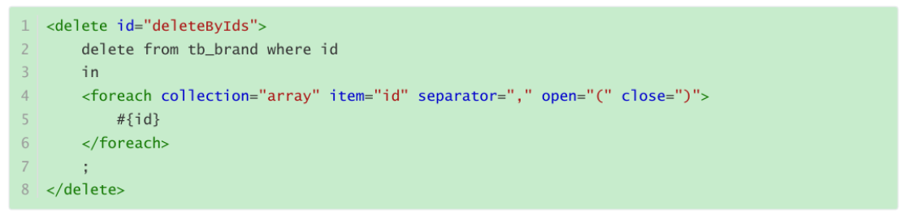


###### 方式2：在sql映射文件中重新给数组起个名字然后在接口方法中用`@Param`参数指向这个数组参数

- 在映射文件中给数组对象起名为`"ids"`（注意：这里不能写成

  `<foreach collection="#{ids}" item="id" separator=",">`

  因为使用 `<foreach>` 标签时，不需要在 `collection` 属性中使用占位符 `#{}`。这是因为 `collection` 属性指的是传入到 SQL 映射文件中的集合参数的名称，而这个名称是通过接口方法中使用 `@Param` 注解定义的。）

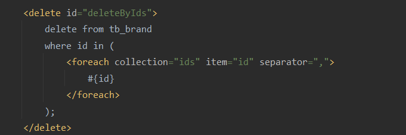

- 在接口方法中使用`@Param`参数指向这个数组参数

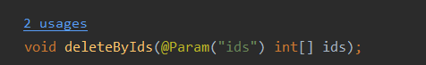


### （4）修改

#### notes：注意这里要使用`<set>`标签

因为假如第一个if标签满足其余的if标签都不满足的话则最终的sql语句为：

`update tb_brand set brand_name=#{brandName}, where id=#{id};`

这里出现了sql语法错误（多了一个`,`），而<set>标签可以自动处理这些问题

## notes：mybatis中使用属性时是否需要`#{}`占位符

在mybatis中当mapper接口的方法传入一个POJO类对象的时候，我们可以在对应的sql映射文件中直接使用该对象的属性，但是在利用该对象的属性进行赋值的时候一定得加上`#{}`的占位符，举例：在下述的修改语句中我们首先会判断传入对象的`brandName`属性值是否为空`<if test="brandName!=null and brandName!='' ">`，这里就直接使用了该POJO对象的`brandName`属性值没有采用占位符；后续将数据库表中的`brand_name`字段赋值成POJO对象的`brandName`属性值的时候就使用了`#{}`占位符`brand_name=#{brandName}`

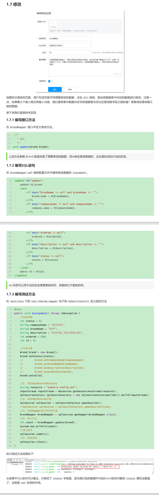


### （5）查询

#### ①查询所有数据

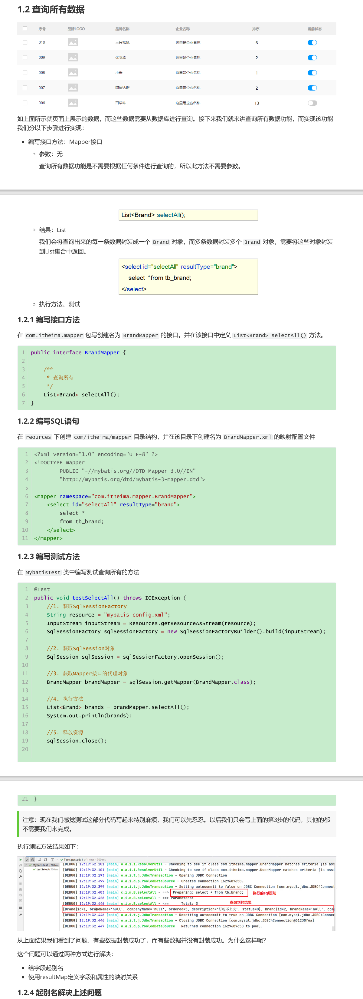


#### notes：当出现数据库表的列名和POJO类属性名不匹配的时候该怎么办

##### 方式1：在查询的时候给表列名起一个别名

##### 方式2：使用resultMap将表的列名和POJO类属性名之间构建映射关系

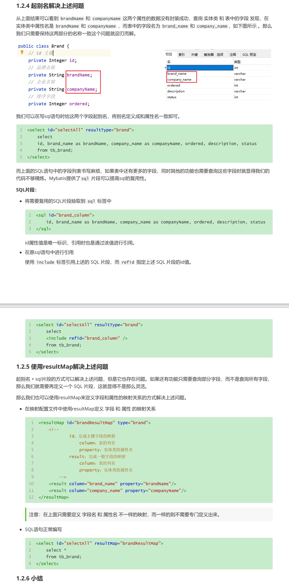

#### ②查询一个数据

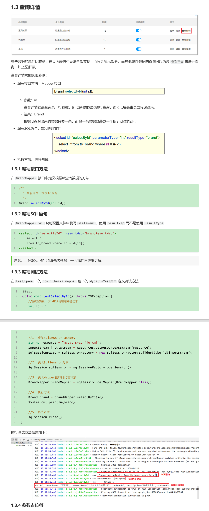


##### notes：参数占位符`#{}`和`${}`

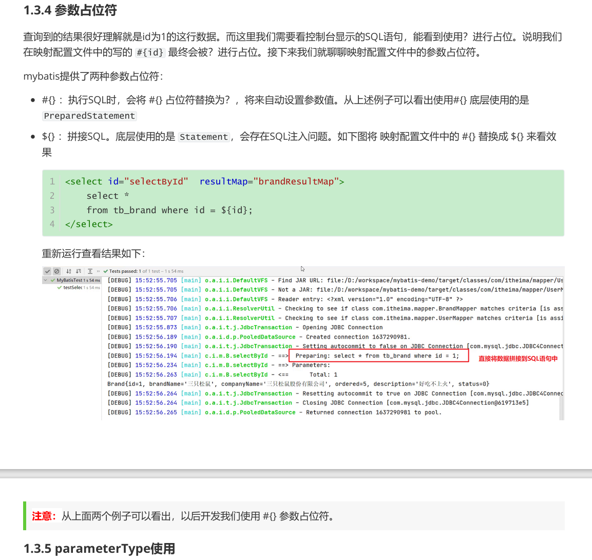


##### notes：sql映射文件中`parameterType`参数的使用

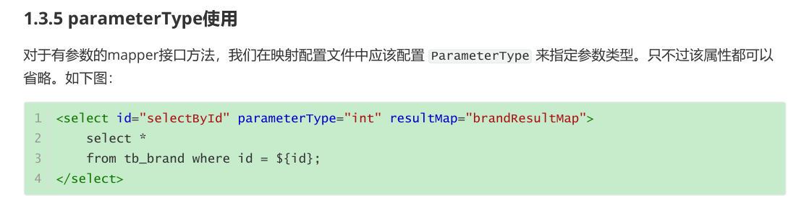


##### notes：sql语句中特殊字段的处理

###### 方式1：转义字符

###### 方式2：CDATA区（使用的时候输入大写的CD就有提示生成了，然后在其中输入我们想输入的特殊字符就可以了）

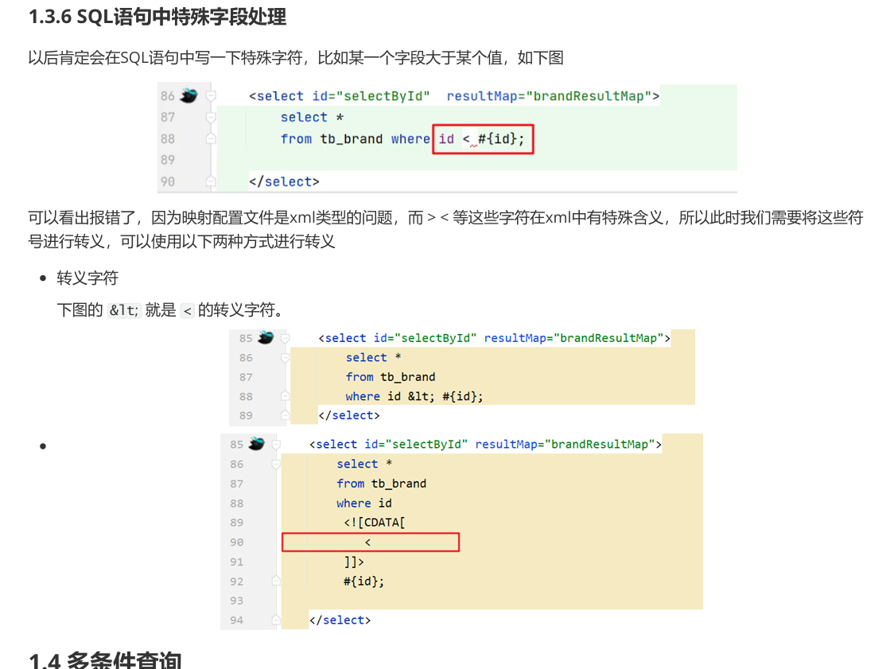


#### ③多条件查询

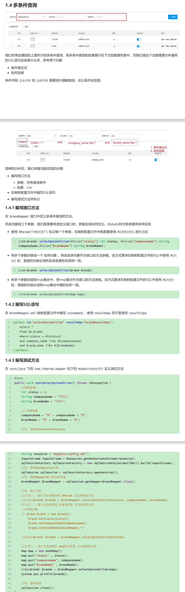


##### notes：接口方法中`@Param`参数

###### 是什么：

在定义的接口方法中可能会有很多形参，这些形参都是与sql映射文件中的参数一一对应的，但是具体哪一个形参对应映射文件中的哪一个参数是不清楚的，所以就需要在接口方法中使用`@Param`参数来指定当前的形参对应映射文件中的哪一个参数（==注意这里的映射文件中的参数不是指数据库表中的列名而是`#{}`占位符中的参数，其实很好理解：就是拿接口方法中的形参替代`#{}`占位符中的参数==）

举例：

```java
//Mapper接口中的方法
public interface UserMapper {
    List<User> findUsersByIdAndStatus(@Param("userId") int a, @Param("userStatus") String b);
}
```


```xml
<!--sql映射文件-->
<mapper namespace="com.example.mapper.UserMapper">
    <!-- 使用 @Param 注解定义的名称来引用参数 -->
    <select id="findUsersByIdAndStatus" resultType="com.example.model.User">
        SELECT * FROM users
        WHERE id = #{userId} AND status = #{userStatus}
    </select>
</mapper>
```

这里在接口方法中使用`@Param("userId")`参数表明用int型数据a替换sql映射文件中`#{}`占位符中的`userId`参数，使用`@Param("userStatus")`参数表明用String型数据b替换sql映射文件中`#{}`占位符中的`userStatus`参数


##### notes：多条件动态sql

###### 是什么：

就是需要满足多个查询条件（0-n个查询条件）的sql语句，但是具体多少个查询条件以及是哪些查询条件不确定

###### 怎么办：

 ==`<if>`标签和`<where>`标签==

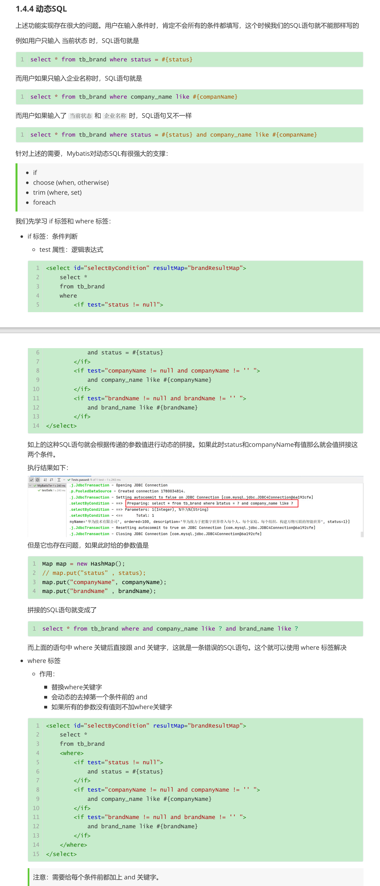


#### ④单条件动态sql

##### 是什么：

查询条件只有一个，但是这个查询条件具体是哪一个是不确定的，比如下面的单选框

##### 怎么办：

==`<choose>`标签和`<when>`标签（相当于`<switch>`标签和`<case>`标签）==

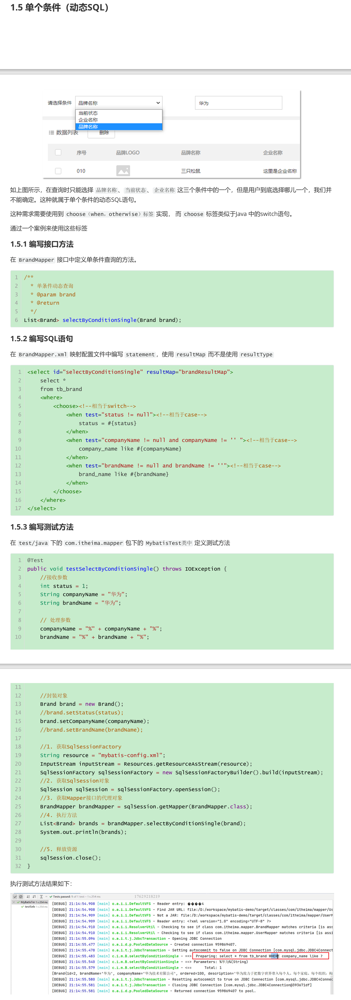


## 6、注解实现CRUD

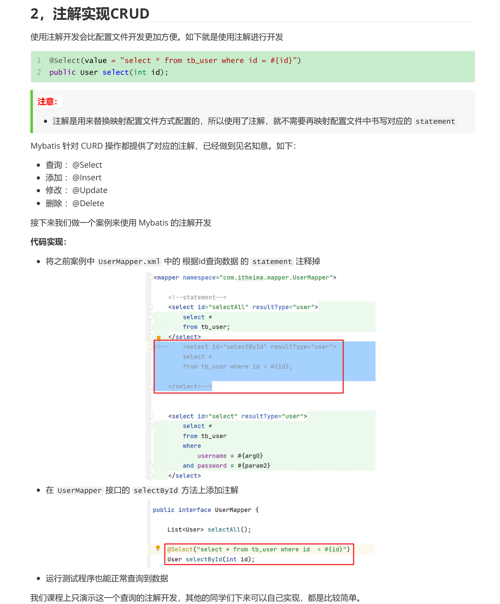