# MyBatisPlus

# notes：飞书云笔记

https://b11et3un53m.feishu.cn/wiki/PsyawI04ei2FQykqfcPcmd7Dnsc


## 1、mybatisplus

### 是什么：

MyBatis-Plus 是 MyBatis 的增强工具，旨在简化 MyBatis 的开发过程。它包括通用 CRUD 操作、分页查询、乐观锁和性能分析等功能，减少了重复代码的编写，提高了开发效率。

### 为什么：

mybatisplus提供了很多现成的增删改查方法，我们只需要继承这些方法就可以直接调用省的自己再去编写

### 怎么办：

#### （1）mybatisplus的使用流程

1. 引入依赖

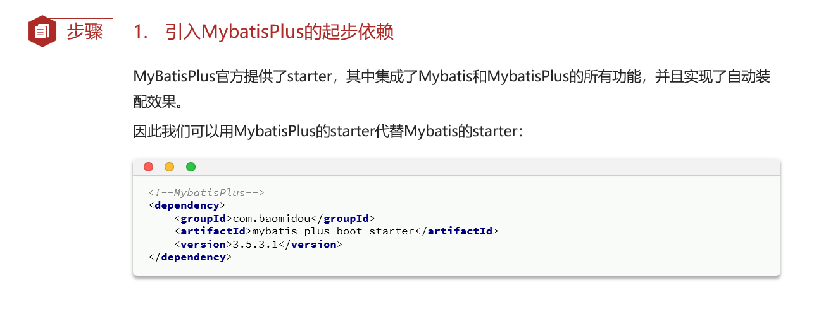

2. 创建mapper层继承mybatisplus中的BaseMapper接口（==BaseMapper接口中一定要声明泛型对应的POJO类，BaseMapper接口中定义了很多数据库的增删改查方法，这些方法都是针对泛型的而不是针对某一个特定的数据类型，声明泛型就是为了说明对什么对象进行增删改查，后续会通过动态代理自动生成sql语句实现对POJO类的增删改查==）

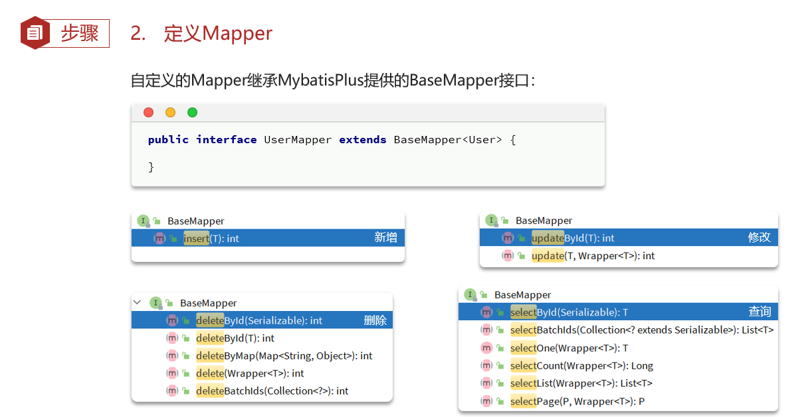

3. 通过创建的mapper层直接调用BaseMapper接口中的增删改查方法


##### notes：通过继承BaseMapper接口继而去调用其中定义的增删改查方法，不用我们去实现接口中定义的方法的吗？

不用。当调用BaseMapper接口中的方法时，动态代理会负责根据调用的方法和传递的泛型参数`POJO`类自动生成相应的 SQL 语句并执行（==这一点解释了为什么在使用BaseMapper接口时一定要注明泛型参数==）。

==**`BaseMapper`** 的基本 CRUD 方法是预定义的，不需要在 XML 中重复编写 SQL，除非你有自定义的复杂查询逻辑，这时你可以选择在 XML 或注解中写自定义 SQL==。


#### （2）mybatisplus如何获取数据库表信息？

#### notes：mybatisplus为什么要获取数据库表信息？

因为之前是我们手写增删改查的sql语句，所以我们知道哪个`POJO`类对应数据库中的哪张表，`POJO`类的哪个属性对应表中的哪个字段，但是现在是mp中现成的增删改查方法，它如何知道数据库表和哪个`POJO`类一一对应呢？所以这就要求mp要获取数据库表信息。

##### notes：一般数据库中的表都和一个POJO实体类一一对应

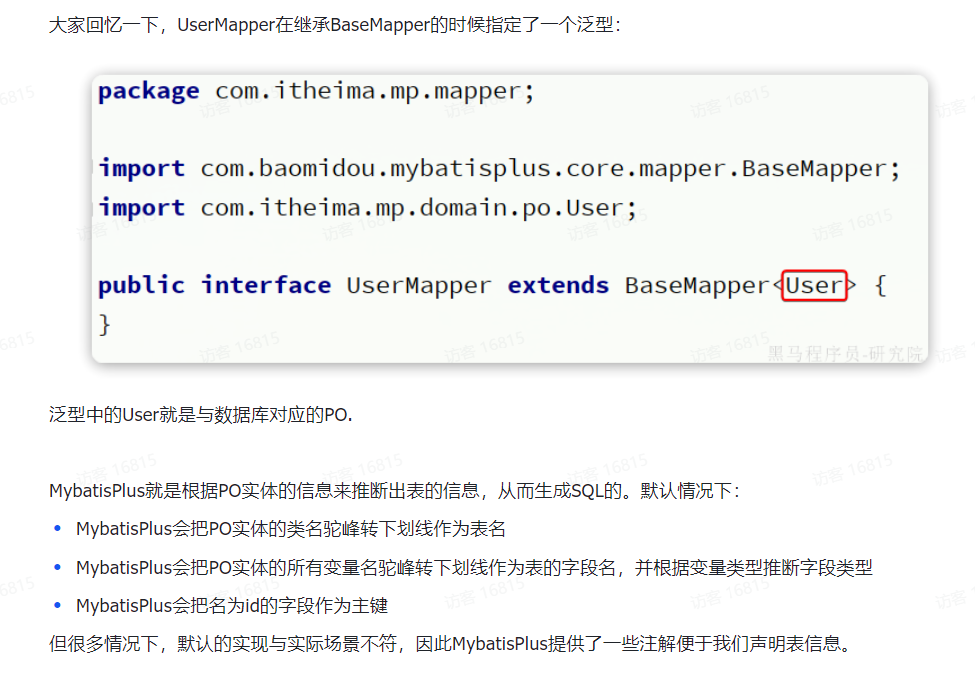

#### （3）mybatisplus中的常见注解

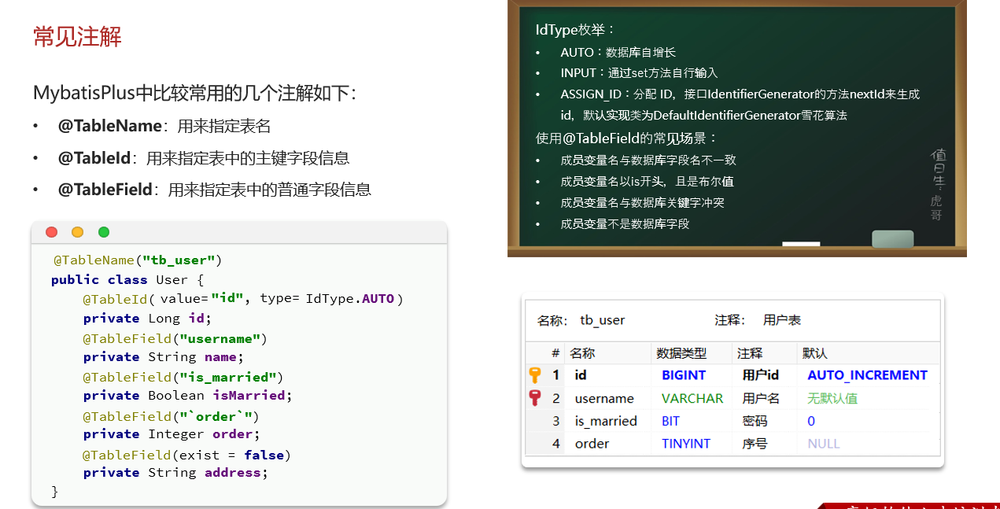


#### （4）配置文件中常见的配置项

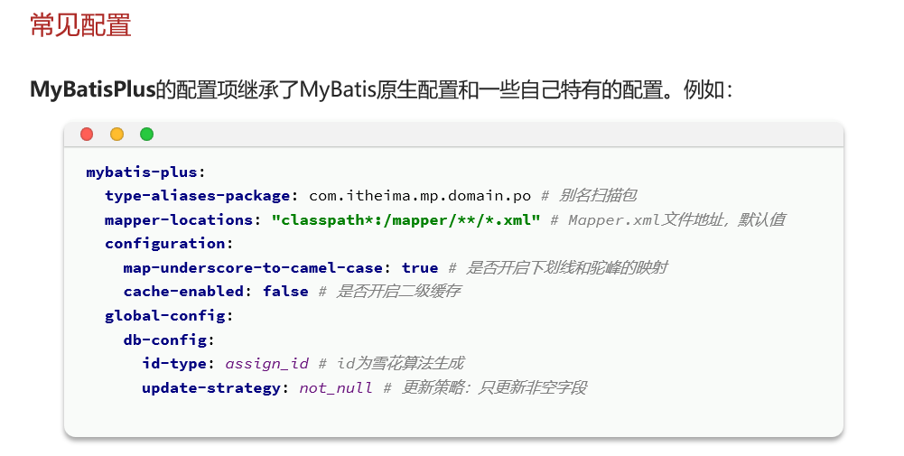


## 2、条件构造器

### 是什么：

MyBatis-Plus 中的 **条件构造器（Wrapper）** 是用于构建原始sql语句中where语句的部分，它简化了 WHERE 条件的构建，但它仅适用于基础的查询和过滤逻辑，并不能处理复杂的 SQL 操作（例如多表 JOIN、子查询等）MyBatis-Plus 提供了几个主要的条件构造器接口，最常用的是 `QueryWrapper` 和 `LambdaQueryWrapper`。

### 为什么：

#### （1）为什么要使用条件构造器？

- 因为在`mybatisplus`的`BaseMapper`接口中定义好的增删改查方法都是最简单的增删改查方法，并不涉及复杂的逻辑筛选条件（比如删除`user`表中姓名为`"Alice"`的用户），所以得加上条件构造器进行条件的筛选。但是原本使用`mybatis`时也没有条件构造器啊，那时是咋做的？那会是通过在`mapper.xml`文件中自己手写`sql`语句进行查询，但是现在我们希望偷懒直接调用`BaseMapper`中现成的方法进行查询，但是现成的方法中又没有筛选条件，所以我们得通过条件构造器给现成的方法添加过滤的条件。
- 相较于原始的通过where语句构成筛选条件，通过条件构造器构成筛选条件更加简单
- 原始过程中需要在mapper.xml文件中写明where语句构造筛选条件，而现在通过条件构造器可以直接在Service层构造筛选条件，业务代码和sql逻辑不分离

### 怎么办：

#### （1）如何使用常见的条件构造器？

##### ①`QueryWrapper`

`QueryWrapper` 是 MyBatis-Plus 提供的一个通用条件构造器，用于构建查询条件。它支持链式调用，能方便地构建各种查询条件。常用的方法包括 `eq()等于`、`ne()不等于`、`like()模糊查询`、`gt()大于`、`lt()小于` 、`select()指明要查询的字段`等。

**示例1：通过条件构造器进行查询操作**

```java
// 假设有一个 User 实体类
QueryWrapper<User> queryWrapper = new QueryWrapper<>();
queryWrapper.eq("name", "Tom")  // WHERE name = 'Tom'
            .ge("age", 18)     // AND age >= 18
            .like("email", "@gmail.com");  // AND email LIKE '%@gmail.com'

// 使用构造的条件进行查询
List<User> users = userMapper.selectList(queryWrapper);
```

这个查询条件会查找所有 `name` 为 "Tom"，且 `age` 大于等于 18，并且 `email` 中包含 "@gmail.com" 的用户。

**示例2：通过条件构造器进行筛选，然后进行更新操作**

```java
// 构建更新条件
QueryWrapper<User> queryWrapper = new QueryWrapper<>();
queryWrapper.eq("status", "inactive");  // 条件：状态为 inactive

// 设置更新的字段和值
User user = new User();
user.setAge(30);  // 将符合条件的用户年龄更新为 30

// 执行更新操作
int rows = userMapper.update(user, queryWrapper);
System.out.println("更新了 " + rows + " 条记录");
```

这个查询条件会查找所有`status`为"inactive"的用户，然后将他们的年龄都设置成30

###### notes：为什么更新时需要传入实体对象？

在 MyBatis-Plus 的更新操作中，`update()` 方法需要两个参数：

1. **更新的实体对象**：用来指定要更新的字段和值（通过 `set` 方法设置）。
2. **条件构造器**：用来指定需要更新的记录的条件（可以是 `QueryWrapper`、`LambdaQueryWrapper` 或 `UpdateWrapper`）。

`update()` 方法根据提供的条件构造器，去匹配数据库中的记录，然后使用实体对象中的非空字段更新匹配的记录。

**示例3：通过条件构造器进行查询，然后进行删除操作**

```java
QueryWrapper<User> wrapper = new QueryWrapper<>();
wrapper.eq("status", "inactive")
       .lt("age", 18);  // 删除状态为 inactive 且年龄小于 18 的用户

int rows = userMapper.delete(wrapper);
System.out.println("删除了 " + rows + " 条记录");
```


##### ②`LambdaQueryWrapper`

`LambdaQueryWrapper` 是 `QueryWrapper` 的一种类型安全的变体，使用 Java 8 的 Lambda 表达式，可以避免手动输入字段名带来的错误。它更适合避免硬编码字段名，并在字段名变更时更易维护。

**示例：**

```java
LambdaQueryWrapper<User> lambdaQueryWrapper = new LambdaQueryWrapper<>();
lambdaQueryWrapper.eq(User::getName, "Tom")
                  .ge(User::getAge, 18)
                  .like(User::getEmail, "@gmail.com");

// 使用构造的条件进行查询
List<User> users = userMapper.selectList(lambdaQueryWrapper);
```

要注意我们要进行筛选的是表中的字段需要满足一定的条件从而将该条记录筛选出来，但是这里我们提供的是java对象中属性的getter方法，所以这中间有个从POJO类属性到数据表中字段的反射的过程（这个过程是自动执行的，了解到这一点就好）


#### （2）使用条件构造器相较于在mybatis的mapper.xml文件中手写sql语句有哪些优点？

1. **减少 XML 配置，代码集中在 Java 中**

- **传统方式**：需要在 `mapper.xml` 文件中定义 SQL 查询语句，尤其是动态 SQL 条件时，通常会使用 `<if>`、`<where>` 等标签进行拼接，XML 文件容易变得复杂，且 SQL 逻辑分散在 XML 和 Java 代码之间。
- **条件构造器**：将所有的查询条件逻辑放在 Java 代码中，通过链式调用构建查询条件，避免了过多的 XML 配置，使得 SQL 和业务逻辑集中在一起，便于阅读和维护。

**示例：**

```xml
<!-- XML 文件中的动态查询 -->
<select id="selectUsers" resultType="User">
    SELECT * FROM user
    <where>
        <if test="name != null">AND name = #{name}</if>
        <if test="age != null">AND age &gt;= #{age}</if>
    </where>
</select>
```

使用条件构造器，可以简化为：

```java
QueryWrapper<User> queryWrapper = new QueryWrapper<>();
queryWrapper.eq(name != null, "name", name)
            .ge(age != null, "age", age);
List<User> users = userMapper.selectList(queryWrapper);
```

**优点**：在 Java 代码中直接书写查询逻辑，不需要切换到 XML 文件进行修改，代码更集中、更容易理解。

2. **更好地支持动态条件**

- **传统方式**：在 `mapper.xml` 中使用 `<if>`、`<where>` 等标签时，需要小心控制条件的嵌套、拼接，复杂条件时容易出现维护问题。
- **条件构造器**：通过链式调用条件方法（如 `eq()`、`like()`、`gt()` 等），可以更直观地构建动态查询条件，不用担心 XML 中嵌套 `<if>` 的复杂性。

**示例：**

**传统 XML：**

```xml
<select id="findByConditions" resultType="User">
    SELECT * FROM user
    <where>
        <if test="status != null">
            AND status = #{status}
        </if>
        <if test="createdTime != null">
            AND created_time &gt;= #{createdTime}
        </if>
    </where>
</select>
```

**条件构造器：**

```java
QueryWrapper<User> wrapper = new QueryWrapper<>();
wrapper.eq(status != null, "status", status)
       .ge(createdTime != null, "created_time", createdTime);
List<User> users = userMapper.selectList(wrapper);
```

**优点**：条件构造器让动态条件的构建变得更直观，逻辑清晰，不需要处理 XML 中的各种 `<if>` 语句，简化了条件的管理。

3. **增强的类型安全与重构友好性**

- **传统方式**：在 XML 中，字段名是以字符串形式存在的。如果实体类字段名改变，需要手动修改 XML 中的相关字段，维护起来容易出错。
- **条件构造器（特别是 `LambdaQueryWrapper`）**：使用 Java 的 Lambda 表达式来引用实体类的字段，重构时 IDE 可以自动调整相关引用，减少手动修改的工作量，降低出错的概率。

**示例：**

```java
LambdaQueryWrapper<User> wrapper = new LambdaQueryWrapper<>();
wrapper.eq(User::getStatus, status)
       .ge(User::getCreatedTime, createdTime);
```

**优点**：字段名的引用通过方法引用（如 `User::getStatus`），在重构或字段变更时，IDE 可以帮助调整引用，减少错误的风险。

4. **便于复用与封装**

- **传统方式**：在 XML 中，条件查询的复用性较差，很多 SQL 语句需要重复定义。
- **条件构造器**：可以将常用的查询条件封装到方法中，在多个地方复用，减少代码重复。

**示例：**

```java
public QueryWrapper<User> buildQueryWrapper(String status, Date createdTime) {
    QueryWrapper<User> wrapper = new QueryWrapper<>();
    wrapper.eq(status != null, "status", status)
           .ge(createdTime != null, "created_time", createdTime);
    return wrapper;
}
```

**优点**：可以将条件构造封装成一个方法，在需要的时候复用，简化代码管理。


## 3、自定义sql

### 是什么：

自己定义sql语句进行增删改查操作

### 为什么：

#### （1）为什么要自定义sql语句？

mp中现成的增删改查方法都是最简单的方法不支持筛选条件，虽然可以通过wrapper条件构造器构造where筛选条件从而弥补这一缺陷，但是mp无法支持多表查询的缺陷依然无法弥补，所以有些情况还是得自定义sql语句来实现数据的增删改查

### 怎么办：

#### （1）如何自定义sql语句？

1. **根据过滤的条件编写条件构造器（可选，如果不想用Wrapper也可以直接在xml文件中使用where语句）**：

   - 可以继续使用条件构造器（如 `QueryWrapper` 或 `LambdaQueryWrapper`）来构建查询条件

   **注意**：**当查询条件非常复杂时**（例如多表关联查询、子查询、聚合操作等），**条件构造器可能不适合**，这时更好的做法是直接在 `mapper.xml` 文件中手写复杂的查询逻辑。

2. **在 `mapper.xml` 文件中编写增删改查的逻辑**：

   - 对于复杂的 SQL 操作，如多表关联查询、批量更新等，你可以在 `mapper.xml` 文件中手动编写这些 SQL 语句，并通过 Mapper 接口来调用这些自定义 SQL。MyBatis-Plus 不限制你编写自定义 SQL，而是作为对原始 MyBatis 的增强。

3. **在 `mapper.xml` 文件中应用条件构造器**：

   - 在 `mapper.xml` 中，你可以手写where语句构成过滤的逻辑也可以直接使用条件构造器来构成过滤的逻辑（但是条件构造器只适合简单的过滤逻辑，不合适多表关联查询、子查询、聚合操作等），而且自定义sql和条件构造器的结合意义不大（知道这回事就行）

**示例：使用条件构造器 + 自定义 SQL：**

```java
QueryWrapper<User> queryWrapper = new QueryWrapper<>();
queryWrapper.eq("status", "active");  // 动态构建查询条件

List<User> users = userMapper.customQuery(queryWrapper);
```

`mapper.xml` 中的自定义 SQL：

```xml
<select id="customQuery" resultType="com.example.entity.User">
    SELECT * FROM user
    <where>
        ${ew.customSqlSegment}  <!-- 使用条件构造器生成的动态条件 -->
    </where>
</select>
```

**注意**：`${ew.customSqlSegment}` 是 MyBatis-Plus 特有的功能，可以将条件构造器生成的 SQL 片段注入到自定义 SQL 中。


## 4、Service接口

### 是什么：

这里所谓的`Service`接口特指`mp`中提供的`IService`接口，在其中定义了很多现成的增删改查方法，我们可以创建一个`Service`接口去继承`IService`接口从而就可以使用它的众多方法了，避免再去手写很多代码

### 为什么：

#### （1）既然有了`BaseMapper`接口其中定义了很多增删改查方法，为什么现在又弄个`IService`接口出来？

- **BaseMapper** 是 **Mapper 层** 的接口其中定义了很多的增删改查方法，通过继承 **BaseMapper**，可以减少 **Mapper 层** 手写代码。
- **IService** 是 **Service 层** 的接口其中定义了很多的增删改查方法，通过继承 **IService**，可以减少 **Service 层** 手写代码（==其实`IService`接口中定义的增删改查方法内部依然是调用了`BaseMapper`接口中的方法==）。

传统的过程中需要我们创建`Controller`层的增删改查方法去调用`Service`层的增删改查方法，然后`Service`层的增删改查方法去调用`Mapper`层的增删改查方法，现在通过创建`Service`层去继承`IService`接口从而省略了`Service`层和`Mapper`层创建增删改查方法的过程

### 怎么办：

#### （1）如何使用`IService`接口？

`IService`接口---->`ServiceImpl`实现类（该实现类的作用就是实现了`IService`接口中的众多方法）

自定义`Service`接口继承`IService`接口，自定义实现类实现`Service`接口同时继承`ServiceImpl`实现类

eg：

**实体类 `User`：**

```java
@Data
@TableName("user")
public class User {
    @TableId
    private Long id;
    private String name;
    private Integer age;
    private String status;  // 用户状态，如 "active"、"inactive"
}
```

**Controller 层 `UserController`：**

```java
@RestController
public class UserController {

    @Autowired
    private UserService userService;

    @GetMapping("/users")
    public List<User> getAllUsers() {
        return userService.list();  // 调用UserService层的list方法查询所有用户
    }

    @GetMapping("/active-users")
    public List<User> getActiveUsers() {
        return userService.getActiveUsers();//调用UserService层的getActiveUsers方法查询所有状态为active的用户
    }
}
```

**Service 层 `UserService`：**

```java
public interface UserService extends IService<User> {
    List<User> getActiveUsers(); //查询所有状态为 active 的用户（IService接口中并不存在这个方法，所以必须自己定义）
}
```

##### notes：注意这里在`UserService`层中我们只定义了`getActiveUsers`方法，因为`IService`接口中并不存在该方法所以需要手动定义，而我们并没有定义`UserService`层的`list`方法，因为该方法在`IService`接口中已经定义过了（由此可以看出使用`IService`接口可以简化代码的编写）

**Service 层实现类 `UserServiceImpl`：**

```java
@Service
public class UserServiceImpl extends ServiceImpl<UserMapper, User> implements UserService {

    @Override
    public List<User> getActiveUsers() {
        QueryWrapper<User> queryWrapper = new QueryWrapper<>();
        queryWrapper.eq("status", "active");  // 直接使用字符串表示字段
        return this.list(queryWrapper);  //调用Service层的list()方法执行查询（它的底层是去调用UserMapper层中的方法）
    }
}
```

##### notes：这里`ServiceImpl`实现类为什么一定要标注泛型为`<UserMapper, User>`？

- 因为这里是要操作`User`对象，通过第二个参数指明要操作的对象
- 前面已经说过了`IService`接口中定义的增删改查方法其实底层还是调用`BaseMapper`接口中的增删改查方法，这里声明了第一个参数为`UserMapper`，到时候在`Service`层使用方法的时候就知道去调用`UserMapper`那里的方法了。

**Mapper 层 `UserMapper`：**

```java
public interface UserMapper extends BaseMapper<User> {
}
```


## 5、代码生成

### 是什么：

在使用MybatisPlus以后，基础的Mapper、Service、PO代码相对固定，重复编写也比较麻烦。因此MybatisPlus官方提供了代码生成器根据数据库表结构生成PO、Mapper、Service等相关代码。只不过代码生成器同样要编码使用，也很麻烦。

这里推荐大家使用一款MybatisPlus的插件，它可以基于图形化界面完成MybatisPlus的代码生成，非常简单。

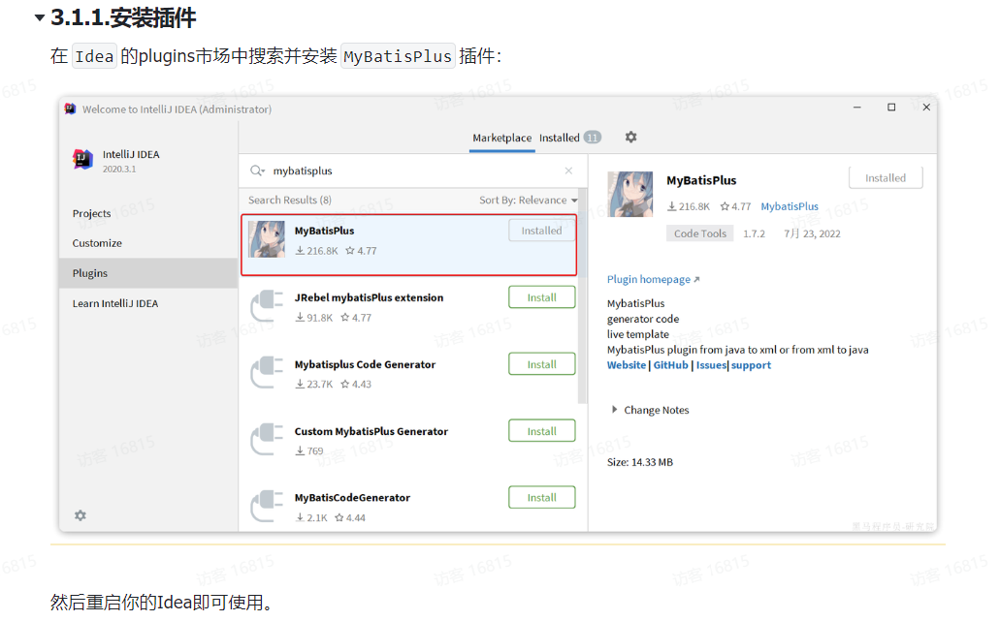

### 怎么办：

#### （1）如何使用mybatis-plus插件实现代码的自动生成？

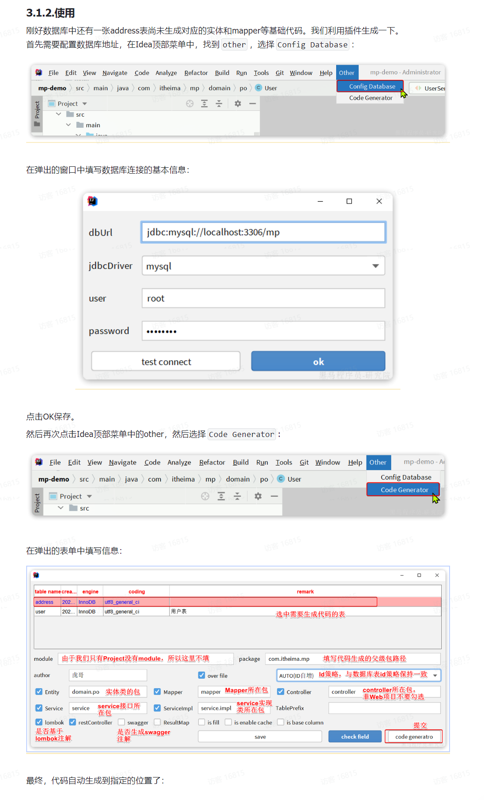


## 6、逻辑删除

### 是什么：

对于一些比较重要的数据，我们并不会真正的在数据库中删除它而是采取的逻辑删除的方案，即：

- 在表中添加一个字段标记数据是否被删除

- 当删除数据时把标记置为true

- 查询时过滤掉标记为true的数据

一旦采用了逻辑删除，所有的查询和删除逻辑都要跟着变化，非常麻烦。

### 怎么办：

#### （1）在mp中如何将原始删除改成逻辑删除？

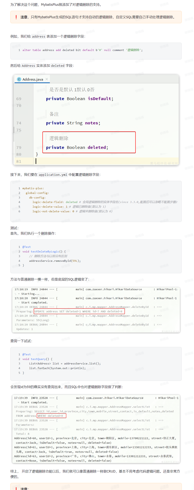

##### notes：注意只有mp自己生成的sql语句（也就是BaseMapper中的方法以及IService接口中的方法自动生成的sql语句）才会自动改成逻辑删除


## 7、通用枚举

### 是什么：

对于POJO类中的一些属性我们改由枚举类进行表示

### 为什么：

对于用户User类中的用户状态Status这样的属性，目前我们的做法是用int类型的数据来表示的，其中1代表正常，2代表不正常，在数据库表中也是这样进行存储的，但是这种表示方法不是很直观（很容易就忘了1到底代表的是什么状态，而且不利于第三方理解），所以我们通过定义枚举类来表示用户的状态（在枚举类中定义属性int value依然表示的是1或者2表示状态的属性，定义属性String info用字符串来介绍该枚举对象，比如：“正常”或“不正常”），枚举类中的对象可以表示为"NORMAL"、"ABNORMAL"，这样就可以很直观的知道用户的状态了

### 怎么办：

#### （1）用枚举类来表示POJO类中的属性有哪些问题？

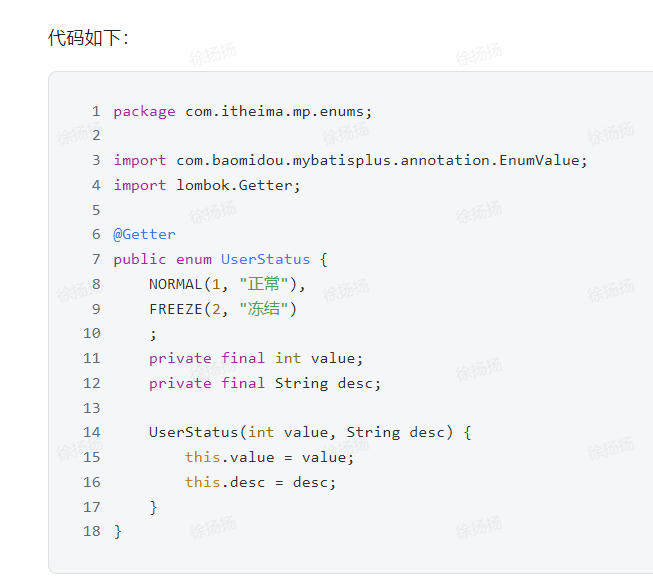

1. 现在通过枚举类的对象确实可以直观的看到User类的状态属性，但是数据库中该如何存储呢？数据库中可没有枚举类哦。

​	数据库中依然是采用int型数据进行存储

2. 枚举类的对象如何和数据库中的int型数据一一对应呢？

   假设现在我们自己来处理这种一一对应的关系该咋办？我们可以先查询数据库中的数据然后看它的状态字段是什么值，如果是1的话则看枚举类中哪个对象的value属性值为1（value属性值对应的就是数据库中的状态字段的值）然后将该枚举类对象赋值给User对象的状态。不过这样太麻烦了，mp提供了一个现成的工具：枚举处理器，它可以用来处理枚举类对象和数据库中int型字段的一一对应关系。


#### （2）枚举处理器

##### 是什么：

是一个mp中的工具，用来处理枚举类对象和数据库中int型字段的一一对应关系的（也不一定非要是int型字段）

##### 怎么办：

###### （1）如何使用枚举处理器？

1. 在配置文件中添加枚举处理器

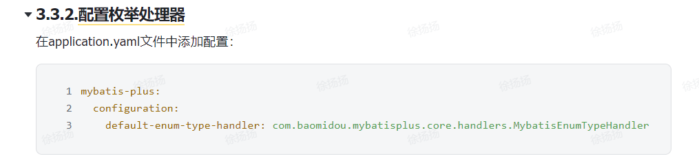

2. 给枚举类中的value属性添加@EnumValue注解（该注解的作用就是表示枚举类中的该属性和数据表中的类型之间一一对应的关系）

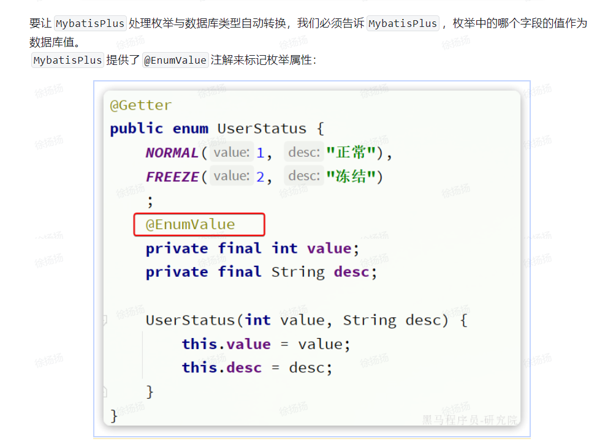

3. 测试（此时枚举类处理器就可以自动生效将枚举类和数据库中的int类型进行一一对应了）

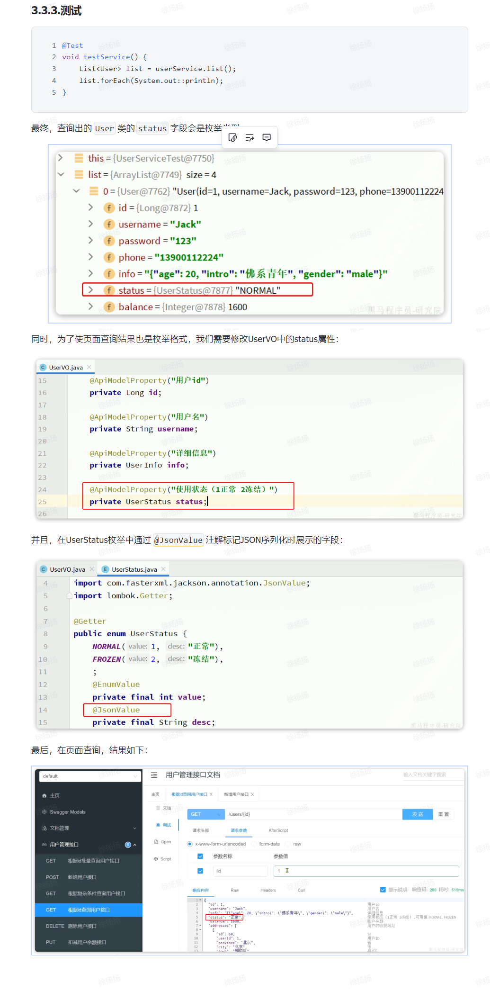


## 7、json类型处理器

### 是什么：

MyBatis-Plus 中的 JSON 类型处理器（如 `JacksonTypeHandler`）是一种工具，用于在数据库中的 JSON 数据和 Java 实体类对象之间进行自动转换。

### 为什么：

#### （1）为什么要使用 JSON 处理器？

在实际项目中，数据库中的某些字段可能存储为 JSON 格式。然而，在 Java 中没有直接的 JSON 数据类型，通常需要将其映射为 `String`、`Map` 或实体类对象。手动进行这种映射转换（将对象转为 JSON 字符串或从 JSON 字符串转回对象）非常繁琐。

MyBatis-Plus 提供的 `JacksonTypeHandler` 可以简化`json`数据与`Java实体类`之间的转换过程，它能够自动完成以下操作：

- **写入时**：将实体类对象序列化为 JSON 字符串存储在数据库中。
- **读取时**：将数据库中的 JSON 字符串反序列化为 Java 对象。

这种处理方式省去了手动转换的繁琐操作，使得开发更为简洁高效。

#### notes：json数据与Java数据之间两种常见的映射方式

1. **使用 `Map` 结构**：因为 JSON 本质上是 `key-value` 的结构，映射到 Java 的 `Map` 对象是比较直观的选择。这种方式适合 JSON 结构不固定、灵活变化的情况。
2. **使用实体类对象**：如果 JSON 数据结构较为稳定，可以定义一个 Java 类对应 JSON 的 `key-value` 结构。这样，JSON 的 `key` 可以映射到 Java 类的属性，`value` 则是属性的值。

### 怎么办：

#### （1）如何使用json处理器？

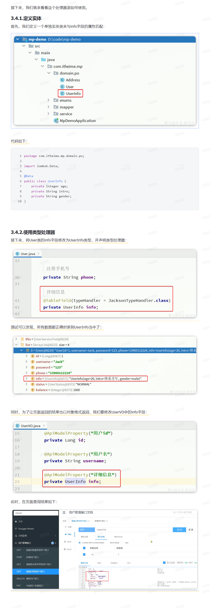


## 8、mp中的分页插件

### 是什么：

是mp中用于引入分页功能的插件

### 为什么：

在未引入分页插件的情况下，`MybatisPlus`是不支持分页功能的，`IService`和`BaseMapper`中的分页方法都无法正常起效。 所以，我们必须配置分页插件。

### 怎么办：

#### （1）如何使用mp的分页插件？

1. 创建分页插件的`bean`组件

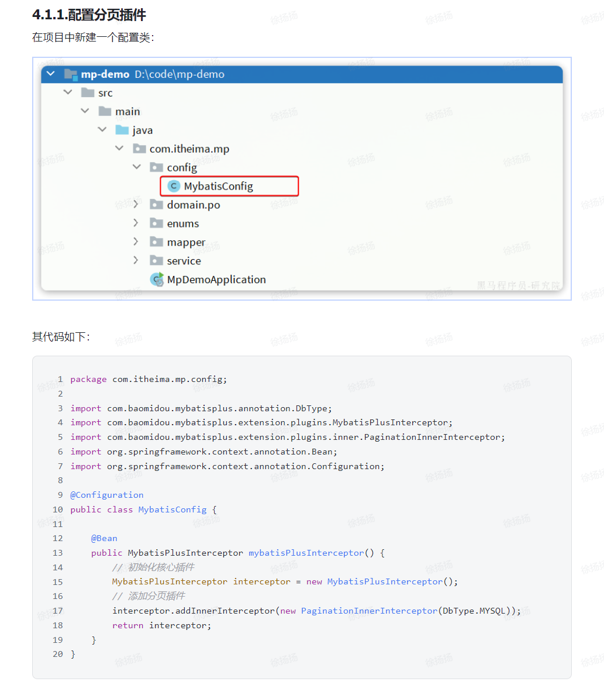

2. 调用`IService`接口或`BaseMapper`接口中的分页方法实现分页查询（这些方法内部的实现逻辑中用到的就是分页插件）

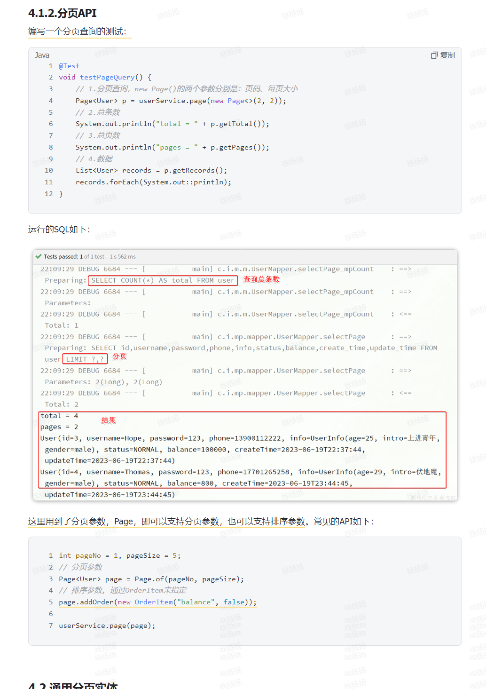


#### （2）`IService`接口中的`page`方法是如何定义的？

```java
Page<T> page(Page<T> page);
Page<T> page(Page<T> page, Wrapper<T> queryWrapper);
```

**方法解析：**

`IService` 提供了两种 `page` 方法，分别支持简单分页和带条件的分页：

1. **`page(Page<T> page)`**：
   - 参数：
     - `page`：`Page<T>` 对象，用于传入分页参数（如页码、每页大小）并接收查询结果。
   - **返回值**：返回 `Page<T>` 对象，包含了分页结果的数据列表、总条数、总页数等信息。
   - **作用**：执行无条件的分页查询，即查询表中所有数据并按分页参数进行分页。
2. **`page(Page<T> page, Wrapper<T> queryWrapper)`**：
   - 参数：
     - `page`：`Page<T>` 对象，传入分页参数（如页码、每页大小）并接收查询结果。
     - `queryWrapper`：用于构建查询条件的 `Wrapper` 对象，比如 `QueryWrapper<T>` 或 `LambdaQueryWrapper<T>`。
   - **返回值**：返回 `Page<T>` 对象，包含了分页结果的数据列表、总条数、总页数等信息。
   - **作用**：执行带条件的分页查询，可以通过 `queryWrapper` 构建查询条件，对数据进行过滤后再进行分页。


#### （3）`Page` 类的定义

`Page<T>` 是 MyBatis-Plus 中用于分页的类，它包含以下属性：

- **current**：当前页码。
- **size**：每页显示的记录数。
- **total**：总记录数。
- **pages**：总页数。
- **records**：当前页的查询结果列表。

#### （4）`page` 方法的工作原理

1. **查询条件解析**：通过 `Page` 和 `QueryWrapper` 解析出分页参数和查询条件。
2. **执行查询**：利用 MyBatis-Plus 的分页插件拦截 SQL 查询语句，添加 `LIMIT` 等分页语句。
3. **填充结果**：MyBatis-Plus 自动执行分页查询，并将查询结果填充到 `Page` 对象中，包含总记录数、总页数和当前页数据列表。