# RabbitMQ

## notes：idea的使用快捷键

1. 查看一个类的层次结构：`ctrl+t`或`ctrl+h`

​	在 IntelliJ IDEA 中，要找到一个抽象类的继承关系树，可以使用以下步骤：

- 选中类：在代码编辑器中，选中你想要查看的抽象类。

- 按 Ctrl + H：这会打开“继承层次结构”视图，显示该类的所有子类和父类关系。

- 查看类结构：在弹出的窗口中，你可以看到继承关系树，并可以展开各个子类来查看更多信息。

​	如果按 Ctrl + T，通常会打开“类型层次结构”，这也能帮助你查看类型关系，但 Ctrl + H 更直接用于查看继承关系。

2. 查看一个方法的参数提示：`ctrl+p`

## 1、RabbitMQ

### 是什么：

RabbitMQ 是一个消息代理软件，基于 AMQP（高级消息队列协议）构建。它用于在分布式系统中进行消息传递，允许应用程序之间异步地交换数据。

#### notes：同步调用和异步调用

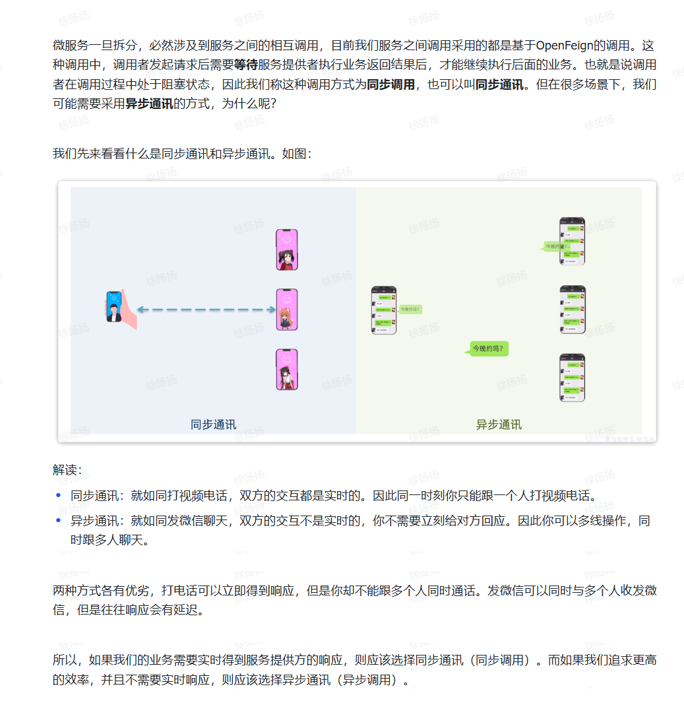

### 为什么：

#### （1）为什么要使用MQ？

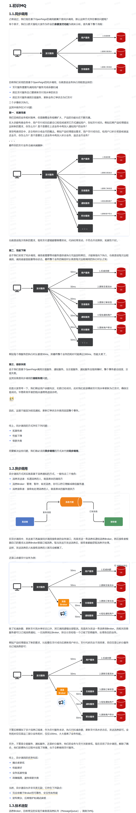

### 怎么办：

#### （1）如何安装RabbitMQ？

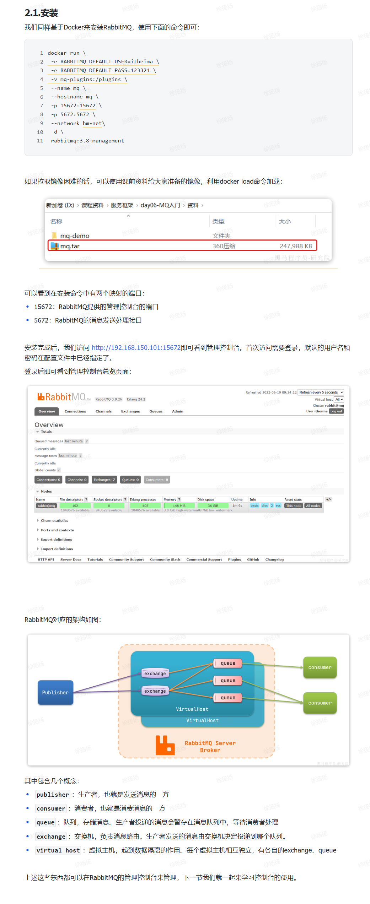

#### （2）如何利用`rabbitmq`控制台实现收发消息？

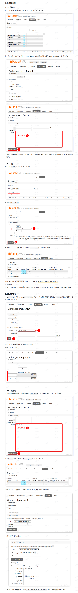

#### （3）如何实现`rabbitmq`中的数据隔离？

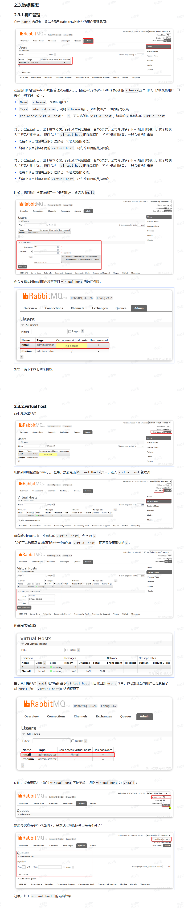

##### notes：什么是`rabbitmq`中的数据隔离？

RabbitMQ 中的数据隔离是指在不同的消费者或应用程序之间，确保消息数据的独立性和安全性。这可以通过以下方式实现：

- 虚拟主机（`virtual host`）：`RabbitMQ` 使用虚拟主机来创建隔离的环境。同一个用户下可以创建不同的虚拟主机，虚拟主机之间是相互隔离的。每个虚拟主机可以有独立的队列、交换机，用户可以给不同的应用设置不同的虚拟主机从而在不同的虚拟主机内发送消息实现消息的隔离。

##### notes：为什么要实现`rabbitmq`中的数据隔离？

因为在同一个`rabbitmq`中会有多个用户或者一个用户会给多个应用发送消息，比如：

- A用户通过`queue1`发送消息
- B用户通过`queue1`发送消息

如果这两个队列不隔离的话则消息通信会受影响，所以可以分别给这两个用户创建不同的虚拟主机：

- A用户在虚拟主机1下的`queue1`发送消息
- B用户在虚拟主机2下的`queue1`发送消息

如此一来这两个用户发送消息就互不干扰了

## 2、SpringAMQP

### 是什么：

`spring`框架集成的用来使用`rabbitmq`的一套工具，通过它我们可以实现通过编码使用`rabbitmq`实现消息队列的功能

### 为什么：

在上述过程中我们都是通过`rabbitmq`的控制台实现消息的发送与接收，现在可以通过代码实现交换机的创建、队列的创建、队列与交换机的绑定、消息的发送与接收这全部的过程，更加方便

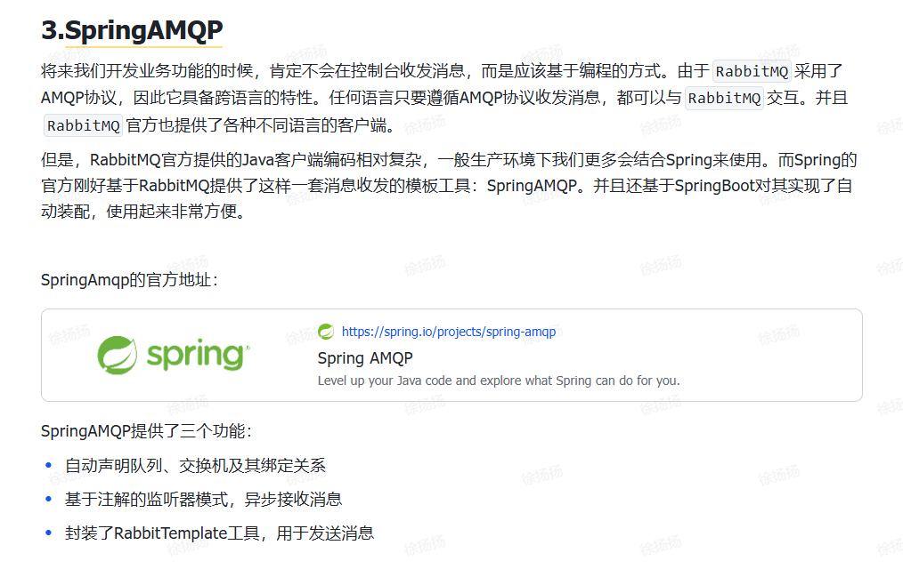

### 怎么办：

#### （1）如何使用`springAMQP`实现消息的发送与接收？

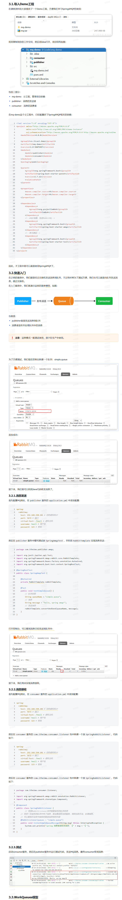

##### notes：上述通过代码实现消息的发送与接收中生产者和消费者如何操作？

- 生产者：通过`convertAndSend`方法将消息对象==发送给交换机或者队列==（这其中牵扯到将消息对象的实体序列化为字节的过程）
- 消费者：==通过形参直接获取队列中的消息==（这其中牵扯到将字节反序列化为消息对象实体的反序列化过程）

## 3、WorkQueue模型

### 是什么：

就是让多个消费者去订阅同一个消息队列从而共同处理队列中的消息，默认情况下队列中的消息是平均分配的（哪怕各个消费者的消费速度不一致也是平均分配），可以通过设置使得消息不用平均分配

### 为什么：

#### （1）为什么要使用`WorkQueue`模型？

消息队列中的读写速度不一致（当消息处理很耗时的时候，生产消息的速度远快于消费消息的速度）由此带来消息在队列中的堆积无法处理，所以就需要多个消费者一起处理消息。

### notes：注意`WorkQueue`模型与`Fanout`交换机之间的区别

1. 二者应用的对象不同
   - `WorkQueue`模型：应用在消息队列和消费者之间
   - `Fanout`交换机：应用在交换机和消息队列之间
2. 二者的工作模式不同
   - `WorkQueue`模型：将队列中的消息发送给多个消费者（默认是平均分配消息），队列中有多少份消息就发送多少份无法复制消息
   - `Fanout`交换机：将生产者发送的一份消息复制多份通过广播发送给每一个消息队列

### 怎么办：

#### （1）如何使用`workqueue`模型？

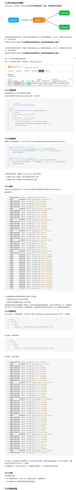

## 4、交换机

### 是什么：

用来进行消息转发的工具，生产者的消息通过发送给交换机，由交换机负责进行路由转发给对应的消息队列

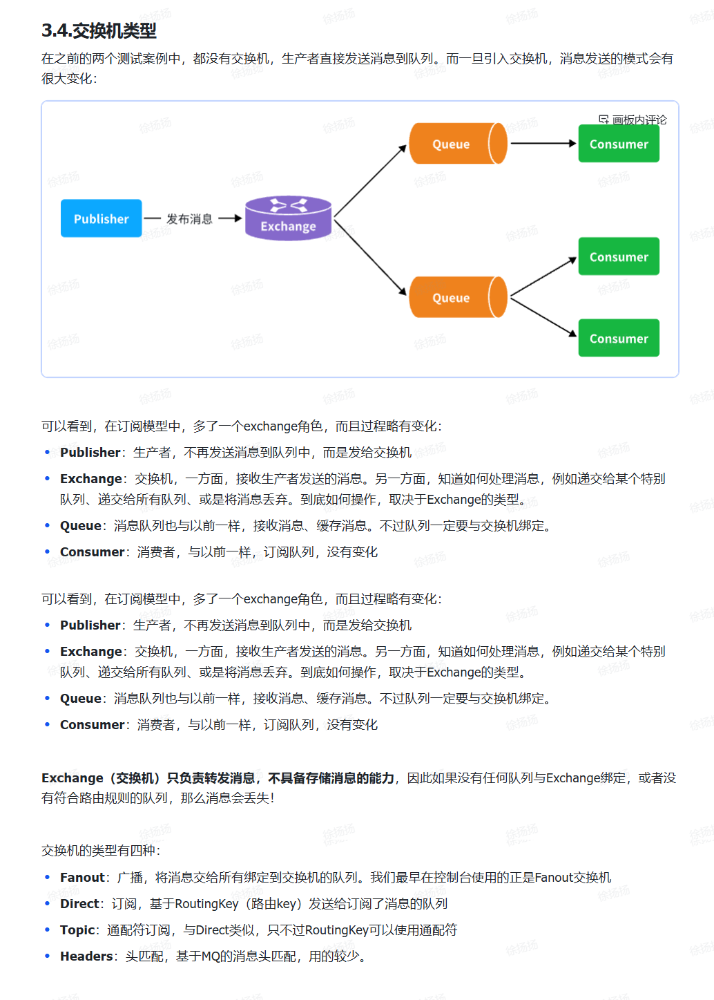

### 怎么办：

#### （1）`Fanout`交换机（广播交换机）

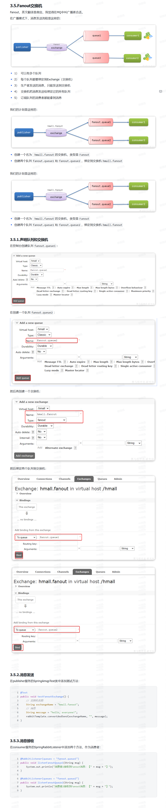

#### （2）`Direct`交换机

##### 是什么：

队列和`Direct`交换机之间进行绑定并且指定一个`bindingKey`，生产者发送消息给`Direct`交换机的时候给消息也指定一个`bindingKey`，如果这两个`bindingKey`完全一致则`Direct`交换机才会将消息转发给这个队列。

##### 怎么办：

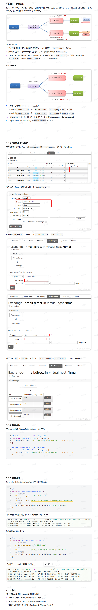

#### （3）`Topic`交换机

##### 是什么：

和`Direct`交换机差不多不同的地方在于二者的`bindingKey`的使用不同，队列和`Topic`交换机之间进行绑定并且指定一个`bindingKey`（`Topic`交换机的`bindingKey`可以由多个单词组成，单词之间用`.`分割，也可以使用通配符），生产者发送消息给`Topic`交换机的时候也给消息指定一个`bindingKey`，如果这两个`bindingKey`匹配上了则`Topic`交换机才会将消息转发给这个队列。

##### 怎么办：

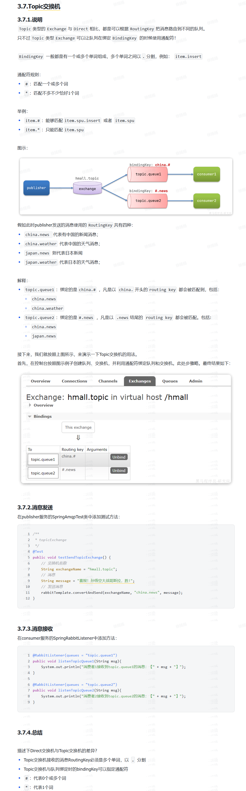

## 5、通过代码创建交换机、创建队列、绑定队列和交换机

### 是什么：

前面我们都是在`rabbitmq`的控制台中创建交换机、创建队列、绑定交换机和队列，但是这样不太方便，所以我们使用代码来完成这些操作

### 怎么办：

#### （1）如何通过代码创建交换机和队列以及绑定队列和交换机？

##### ①方式1：通过配置类中的bean方法创建队列和交换机以及绑定队列和交换机（麻烦）

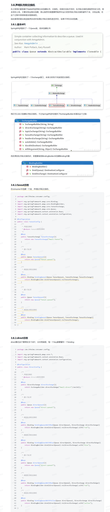

##### ②方式2：通过注解创建队列和交换机以及绑定队列和交换机（更加方便）

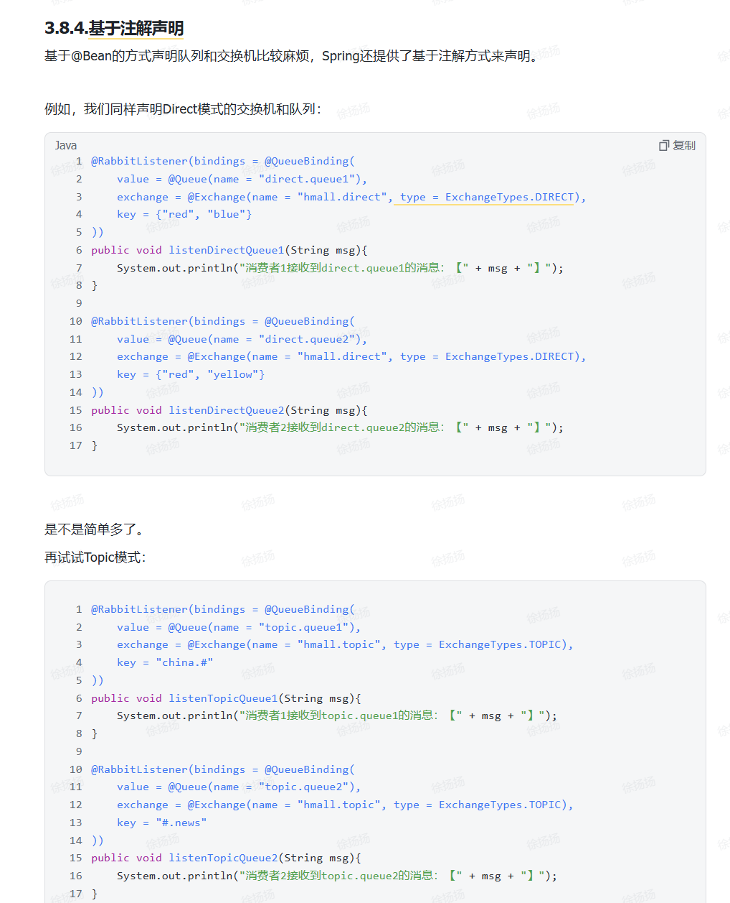

## 6、json转换器

### 是什么：

我们将消息对象发送给`rabbitmq`的过程中需要首先将消息对象进行序列化为字节然后再将字节反序列化为消息对象，这个过程中`spring`框架默认采用的是`jdk`序列化（`jdk`序列化过程中面临很多缺陷），所以我们采用`json`方式进行序列化和反序列化

### 怎么办：

#### （1）如何使用`json`转换器？

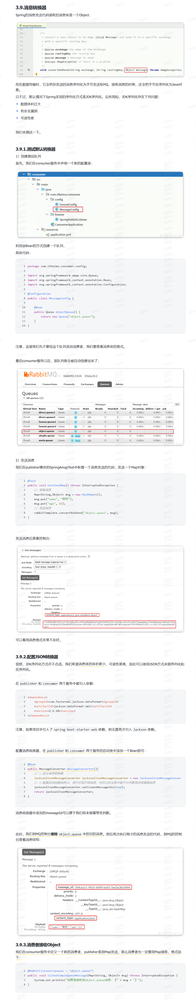

# 二、RabbitMQ高级篇

## 1、MQ的消息可靠性

### 是什么：

生产者将消息发送给消息队列`mq`，然后消费者从消息队列中获取消息进行处理，在这个过程中可能会出现很多问题导致最终消费者没有正确处理该消息，为了避免这个问题需要采取一系列措施保证`mq`的消息可靠性即消息至少被消费者处理一次

### 怎么办：

#### （1）如何保证`mq`的消息可靠性？

消息从生产者到达消息队列然后到达消费者的这个过程中可能都会出现问题，因此我们需要保证整个流程的可靠性，具体如下：

##### ①生产者可靠性

##### ②MQ的可靠性

##### ③消费者的可靠性

## 2、生产者可靠性

### 是什么：

消息从生产者发送到消息队列的过程中可能会发生丢失，因此生产者可靠性就是确保消息一定会从生产者发送到消息队列`mq`的过程

### 怎么办：

#### （1）如何确保生产者可靠性？

主要依赖于生产者重试机制和生产者确认机制：

##### ①生产者重试

##### 是什么：

当生产者和消息队列之间的网络连接出现问题时，重试机制能够确保消息被重新发送。为了实现这一点，生产者通常会在网络连接失败后进行一定次数的重试。

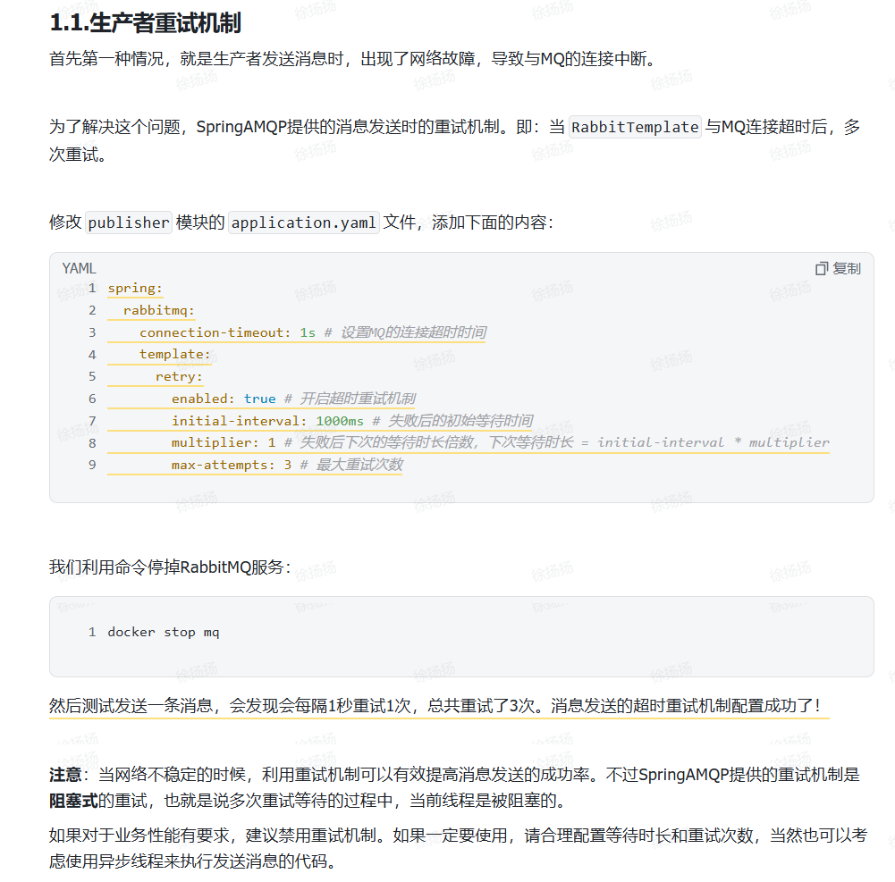

##### ②生产者确认

##### 是什么：

在通过生产者重试确认了生产者和`mq`之间的网络连接以后采取生产者确认机制确保消息一定会正确发送给`mq`。它主要包含以下概念：

- `publish confirm`：用于确认消息是否成功从生产者发送到`mq`的交换机（Exchange）。

  **工作原理**：
  在`Publish Confirm`模式下，生产者发送消息后，消息队列会通过返回`ack`或`nack`来通知生产者消息==是否成功到达Exchange==：

  - **ack**：消息成功到达Exchange，消息被确认接收。
  - **nack**：消息未能到达Exchange，通常是由于内部错误或资源问题导致。如果收到`nack`，生产者一般会重试发送，确保消息最终能够进入系统。

- `publish return`：==消息成功到达了Exchange，但由于没有匹配的队列（如未绑定队列或路由键不匹配）==，消息无法投递到最终目标。

- `confirmCallback`：是生产者在使用`Publish Confirm`机制时的回调接口，用于接收消息是否成功到达Exchange的确认信息。这个回调函数在收到`ack`或`nack`时触发，以通知生产者消息的投递结果。

- `returnCallback`：是生产者在使用`Publish Return`机制时的回调接口，用于接收消息路由失败的信息。如果消息成功到达Exchange但未能路由到任何队列（Queue），则触发`returnCallback`来通知生产者该消息的状态。

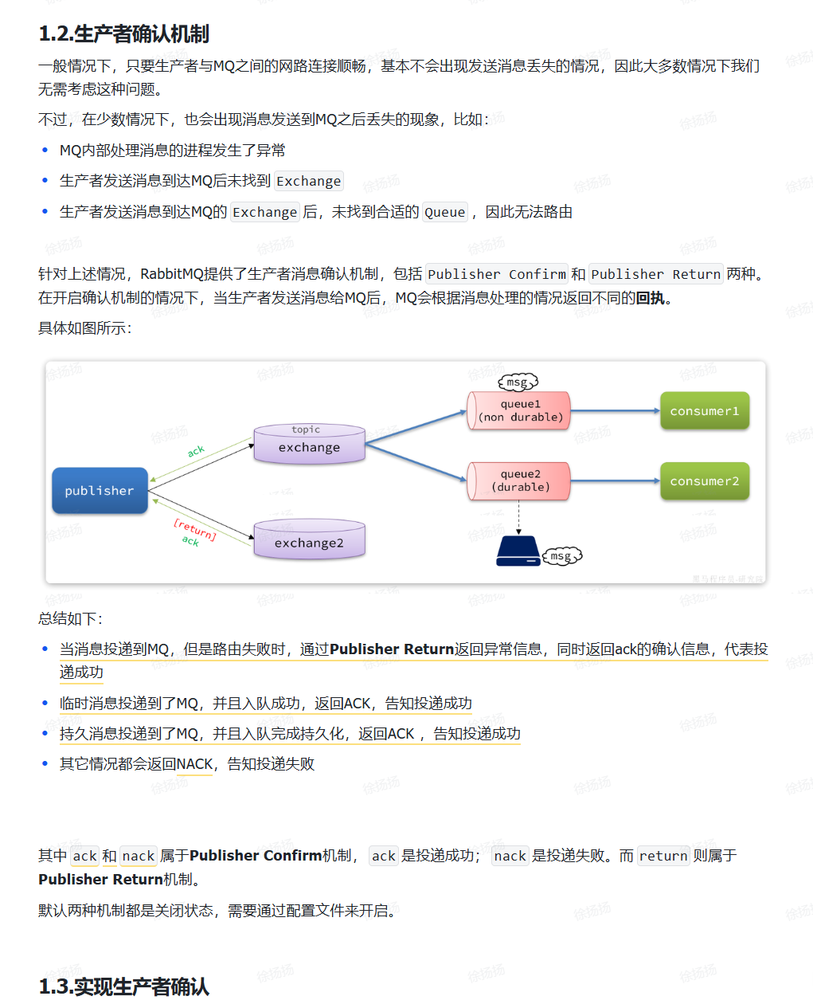

##### 怎么办：

##### （1）如何实现生产者确认？

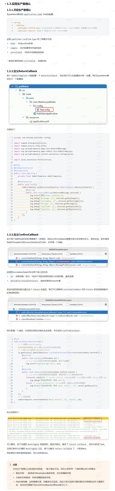

## 3、MQ可靠性

### 是什么：

消费者成功将消息发送到`MQ`以后，`mq`采取一系列措施确保消息不会丢失。

### 怎么办：

#### （1）如何确保`mq`的可靠性呢？

##### ①数据持久化

##### 是什么：

生产者将消息发送到`mq`之后，`mq`将消息写入磁盘中，这样即使重启或者消息丢失也可以去磁盘中寻回

##### 怎么办：

###### （1）如何确保消息持久化？

- 交换机持久化：将交换机的定义（包括交换机的名称、类型和配置等）保存到磁盘。如果RabbitMQ服务器发生重启，持久化的交换机会自动恢复，这样生产者就可以继续向这个交换机发送消息，避免了因为交换机丢失而导致的消息投递失败问题。
- 队列持久化：将队列的定义（包括队列的名称、队列和交换机的绑定关系等）保存到磁盘。如果RabbitMQ服务器发生重启，持久化的队列会自动恢复，这样交换机就可以继续向这个队列发送消息，避免了因为队列丢失而导致的消息投递失败问题。
- 消息持久化：将消息保存到磁盘，以确保在消息队列（MQ）服务器发生重启或崩溃时，消息不会丢失。

notes：**交换机持久化**并不意味着消息持久化。即便交换机是持久化的，如果消息本身没有设置为持久化（即`Delivery mode`为非持久化），这些消息在服务器重启时仍然会丢失。

###### 方式1：在`rabbitMQ`的控制台中控制持久化属性

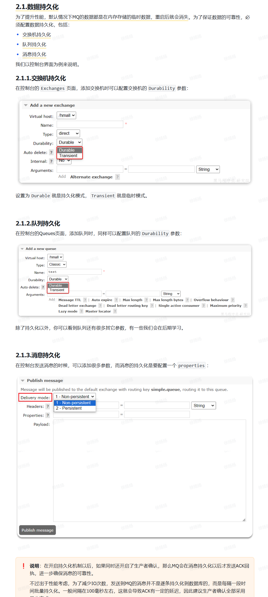

###### 方式2：在发送消息的代码中控制持久化属性

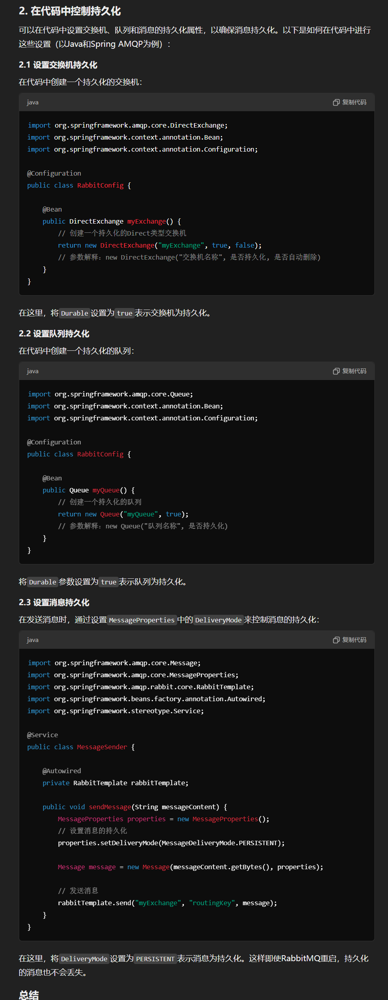

##### ②lazyQueue

##### 是什么：

就是惰性队列。惰性队列的特征如下：

- 接收到消息后直接存入磁盘而非内存
- 消费者要消费消息时才会从磁盘中读取并加载到内存（也就是懒加载）
- 支持数百万条的消息存储

##### 为什么：

###### （1）为什么要使用lazyQueue？

前面消息持久化的过程中我们提到将内存中的消息写入磁盘，这个过程是很频繁、很耗时的而且会阻塞当前进程，当使用`lazyQueue`后直接将消息写入磁盘避免了这个耗时的过程，要使用的时候才去磁盘中读取消息。

##### 怎么办：

###### （1）如何使用`lazyQueue`？

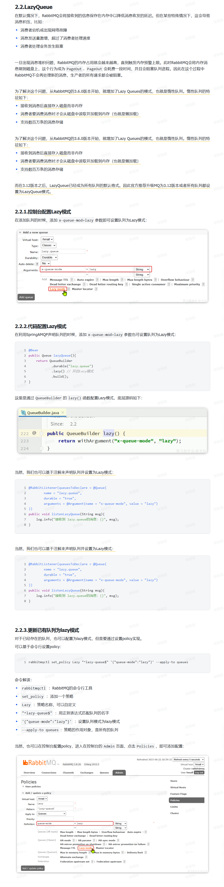

## 4、消费者可靠性

### 是什么：

当RabbitMQ向消费者投递消息以后，并不代表就一定被正确消费了，可能出现的故障有很多，比如：

- 消息投递的过程中出现了网络故障
- 消费者接收到消息后突然宕机
- 消费者接收到消息后，因处理不当导致异常
- 因为网络问题导致消息被重复提交给消费者，重复处理消息也会导致错误

一旦发生上述情况，都表示消息没有被正确处理。因此，需要采取一系列措施保证消费者可靠性。

### 怎么办：

#### （1）如何保证消费者可靠性？

##### ①消费者确认机制

##### 是什么：

当消费者处理消息结束后，应该向RabbitMQ发送一个回执，告知RabbitMQ自己消息处理状态。回执有三种可选值：

- ack：成功处理消息，RabbitMQ从队列中删除该消息
- nack：消息处理失败，RabbitMQ需要再次投递消息
- reject：消息处理失败并拒绝该消息，RabbitMQ从队列中删除该消息

##### 怎么办：

###### （1）如何使用消费者确认机制？

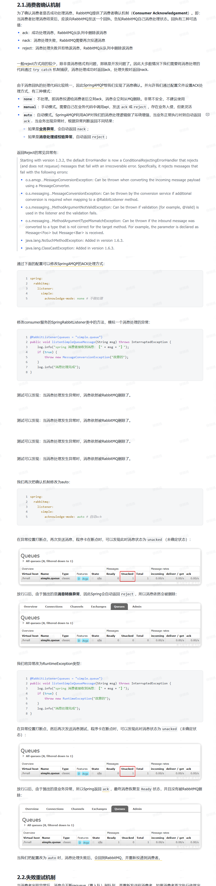

##### ②失败重试机制（本地重试）

##### 是什么：

当消费者出现异常后，一般情况下消息会不断requeue（重入队）到队列，再重新发送给消费者，如果消费者再次执行依然出错，消息会再次requeue到队列，再次投递，直到消息处理成功为止。但是这个过程很耗时，所以启用了失败重试机制：在消费者出现异常时利用本地重试，而不是无限制的requeue到`mq`队列。

###### notes：什么是本地重试？

在RabbitMQ的消费者程序中，本地重试的意思是：当消费者从队列中取到一条消息并尝试处理时，如果遇到一个临时的小故障（比如网络不稳定导致数据库连接失败），它会**直接在代码中再试几次**，而不是把消息放回RabbitMQ队列中等待重新处理。这样做的好处是：

- 避免消息重新进入队列造成不必要的网络传输开销。
- 适合那些小问题，因为很多时候再试一次或几次就能成功。

==本地重试和重新入队的区别==

- **本地重试**：消息没有回到队列，而是消费者自己在代码中多试几次。
- **重新入队**：消息被返回到队列中，等待队列中其他消费者再来取一次。

##### 怎么办：

###### （1）如何使用消费者失败重试机制？

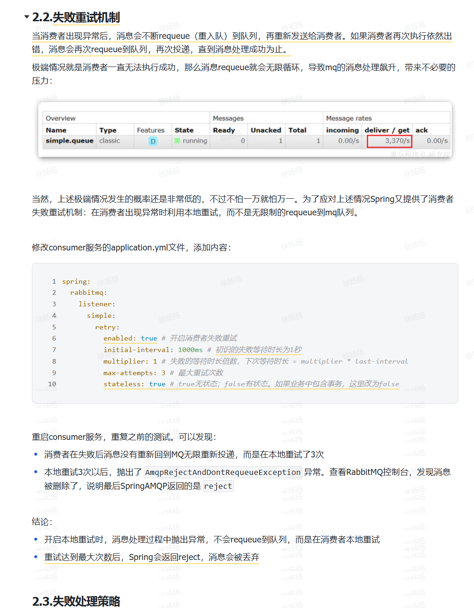

##### ③失败处理策略

##### 是什么：

当消费者从`mq`中收到消息但是处理失败后，经过本地重试依然失败，这时候就要通过失败处理策略来判断到底是直接将这个消息直接丢失还是重新入队接着处理还是将这个消息放入一个特定的队列后续集中处理

##### 怎么办：

###### （1）如何使用消费者失败处理策略？

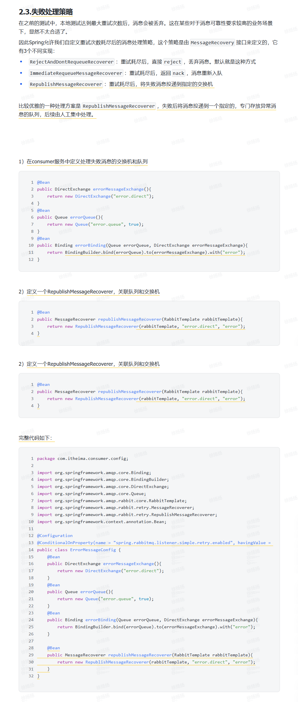

##### ④业务幂等性

##### 是什么：

业务幂等性就是指重复操作不会改变结果。

==业务幂等性举例：==

1. **扣款操作**：假如用户支付时发生了网络波动，导致请求重复发送。为了防止多次扣款，系统应该保证无论用户点击了多少次支付按钮，最终的扣款金额是唯一的。
2. **订单创建**：用户下单时，可能因为网络问题或系统响应慢，导致多次提交请求。幂等性要求系统能够识别出这些请求是重复的，从而只创建一笔订单，而不会生成多个重复订单。

##### 为什么：

###### （1）为什么要有业务幂等性？

在分布式系统中，**网络不稳定、服务超时、消息重复传输**等问题都是常见的。幂等性设计的目的就是为了防止这些因素导致的数据不一致或重复操作。

##### 怎么办：

###### （1）如何实现业务幂等性？

要实现业务幂等性，一般会根据业务需求采用一些技术手段，如：

- **唯一标识（请求ID）**：每个请求都带有一个唯一ID（可以使用`uuid`生成一个唯一的`id`标识，也可以通过其他方式生成一个唯一的`id`标识），服务器在处理时先检查该ID是否已经处理过，若已处理则直接返回结果。
- **状态检查**：在执行操作前检查资源的状态，避免重复操作。例如，在订单支付时先检查订单状态，已支付则不再重复处理。

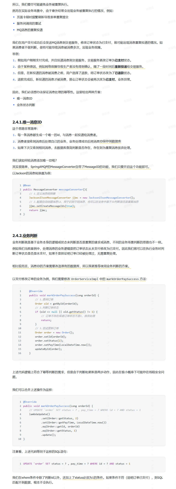

##### ⑤兜底方案

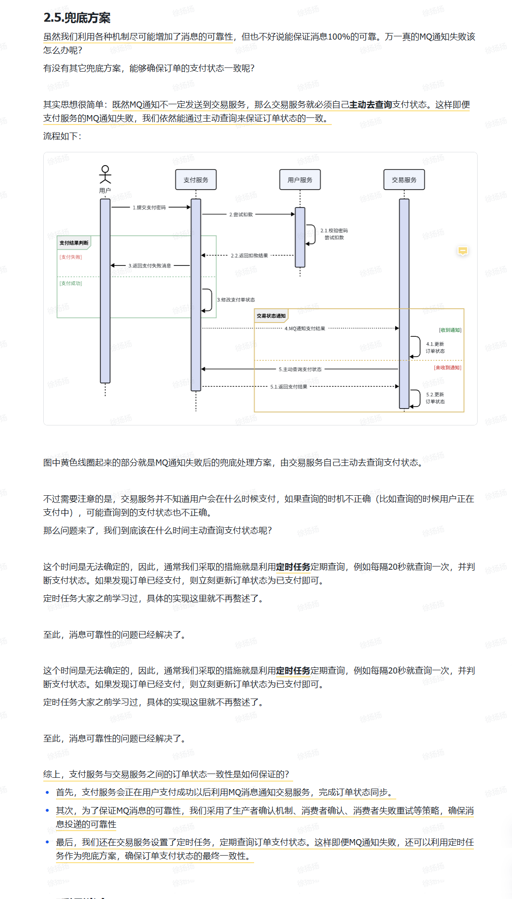

## 5、延迟消息

### 是什么：

**延迟消息**指的是消息在被生产者发送到队列后不会立即被消费者消费，而是要等待一段指定的时间，延迟之后才可以被消费者接收处理。这种机制在实现一些需要定时处理或延时触发的业务场景中非常有用，比如订单超时、延迟通知、定时任务等。

### 怎么办：

#### （1）如何实现延迟消息？

RabbitMQ本身并不直接支持延迟消息，但可以通过以下几种常见的方法实现延迟消息：

##### ①方式1：使用TTL（Time-To-Live）和死信队列（DLX）

这是在RabbitMQ中实现延迟消息的最常用方式，通过结合消息的TTL（生存时间）和死信队列实现。

- **TTL**（Time-To-Live）：TTL是消息的生存时间，可以为消息或队列设置一个TTL值，表示消息在队列中可以存活的时间，超时后消息会被移到死信队列。
- **死信队列（DLX）**：当消息在原队列过期或被拒绝后，会被转发到预先设置好的死信队列（DLX），从而实现延迟处理。

具体步骤：

1. 创建一个主队列（如`delayQueue`），并为该队列设置消息的TTL，假如TTL为10秒。
2. 为主队列绑定一个死信交换机（DLX），并配置死信队列（如`realQueue`）接收消息。
3. 当消息被发送到`delayQueue`时，等待10秒后会自动过期，并被转发到`realQueue`。
4. 消费者监听`realQueue`，从而实现延迟消费。

这种方式的特点是可以为每个消息或整个队列设置统一的延迟时间，但TTL无法精确到具体的秒数，只能大致满足延迟需求。

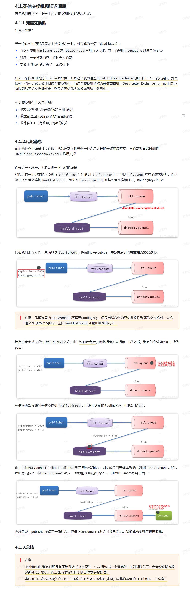

##### ②方式2：使用RabbitMQ延迟插件（RabbitMQ Delayed Message Plugin）

RabbitMQ官方没有原生支持延迟消息，但提供了一个插件——**RabbitMQ Delayed Message Plugin**，该插件允许用户在交换机上设置消息的延迟时间。

- 使用延迟插件的交换机可以接受延迟时间参数，消息到达交换机时会等待指定时间后再路由到目标队列。
- 延迟插件比TTL和死信队列的方式更加灵活，可以为每条消息设置不同的延迟时间，并且无需经过死信队列。

安装和使用方式：

1. 安装RabbitMQ Delayed Message插件。
2. 创建一个带有延迟功能的交换机（通常类型为`x-delayed-message`）。
3. 发送消息时指定延迟时间。
4. 延迟时间过后，消息会自动路由到绑定的队列中，供消费者消费。

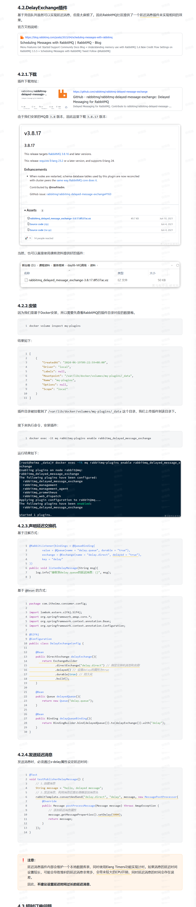

## 6、通过延迟消息解决超时订单问题

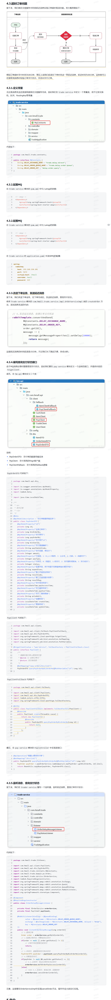